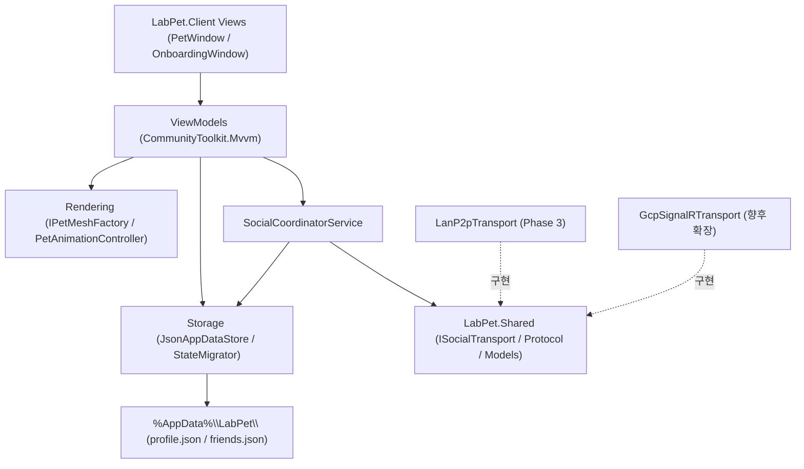

# 02. LabPet 아키텍처 설계서

## 1. 솔루션 계층 및 의존성 규칙
- `LabPet.Shared`는 WPF·네트워크 구현체·OS API에 의존하지 않는 순수 `.NET 10` 클래스 라이브러리다.
- `LabPet.Client`는 `LabPet.Shared`를 참조한다. 화면과 ViewModel은 [SocialCoordinatorService](../src/LabPet.Client/Social/SocialCoordinatorService.cs)를 사용하며, 코디네이터는 `ISocialTransport`에 의존한다.
- 추후 `LabPet.Server`(ASP.NET Core SignalR + Firestore)가 추가되면 `LabPet.Shared`를 그대로 참조해 프로토콜·모델을 공유한다.

## 2. 데이터 일관성 및 오류 처리 규칙
- **원자적 저장(Atomic Write)**: [JsonAppDataStore.cs](../src/LabPet.Client/Storage/JsonAppDataStore.cs)는 `.tmp` 파일에 UTF-8 기록 후 `fs.Flush(true)`를 호출하고, 기존 정상 파일을 `.bak`로 복사한 뒤 `File.Move(..., overwrite: true)`로 교체한다.
- **자동 복구**: 본 파일이 손상되어 역직렬화에 실패하면 `.bak`에서 자동 복구하고, 둘 다 없을 때만 기본 프로필을 생성한다.
- **하위 호환성**: [ProtocolJson.cs](../src/LabPet.Shared/Protocol/ProtocolJson.cs)는 `JsonUnmappedMemberHandling.Skip`을 적용해 향후 상위 버전 필드가 추가되어도 역직렬화가 실패하지 않는다.
- **친구 상태**는 코디네이터가 등록·보상 갱신을 짧은 잠금 안에서 처리하고, 저장 차례가 오면 최신 목록의 복사본을 저장한다. 친구 수락 응답 전에 전송 인증 목록을 갱신한다. UI에는 친구 항목 및 외형의 복사본을 넘긴다. 전송 계층의 주소·외형 갱신과 복사는 같은 친구 항목의 잠금을 사용한다. 성장 보상과 코인 게임 정산은 프로필 직렬화와 같은 진행도 잠금을 사용한다.
- **단일 인스턴스**는 [App.xaml.cs](../src/LabPet.Client/App.xaml.cs)에서 생성한 뮤텍스의 소유권으로 관리한다. 소유한 인스턴스가 종료할 때 뮤텍스를 해제한다.

## 3. 렌더링 및 동시성 원칙
- 순수 WPF `Viewport3D`와 Blender 정적 `.obj` 에셋 로더([BlenderAssetPetMeshFactory.cs](../src/LabPet.Client/Rendering/BlenderAssetPetMeshFactory.cs), [ObjMeshLoader.cs](../src/LabPet.Client/Rendering/ObjMeshLoader.cs)) 및 `HelixToolkit.Geometry.MeshBuilder` 폴백 팩토리([3D 메시 팩토리](../src/LabPet.Client/Rendering/ProceduralPetMeshFactory.cs))를 사용한다. 불변 `MeshGeometry3D`와 고정 재질을 동결해 여러 장면에서 공유하고 `WeakReference` 캐시로 회수를 허용하며, 색상·변환·애니메이션만 장면별로 독립 갱신(무재생성 `UpdateColors` 지원)한다.
- 본체와 외형 편집은 키보드와 음악 효과를 모두 생성한다. 친구 회전 미리보기에서는 해당 효과를 생략하며, 방문 펫은 음악 효과를 생성한다. 친구 목록 갱신 중 선택 변경은 한 번에 반영하고 선택이 해제되거나 창을 닫으면 미리보기 리그를 해제한다. [친구 창](../src/LabPet.Client/Views/SocialWindow.xaml.cs), [방문 펫 창](../src/LabPet.Client/Views/VisitorPetWindow.xaml.cs)
- 바탕화면 펫 뷰포트는 `BitmapCache.RenderAtScale`과 고품질 축소 필터를 사용한다. 이름표 위치는 캐릭터 몸체 하단 기준점과 미니 키보드·회전 링 오라의 앞쪽 하단 기준점을 함께 뷰포트에 투영해 키보드와 오라를 가리지 않도록 계산한다. [바탕화면 펫 창](../src/LabPet.Client/Views/PetWindow.xaml.cs), [WPF 캐시 배율](https://learn.microsoft.com/dotnet/api/system.windows.media.bitmapcache.renderatscale)
- 실행 파일에는 모니터별 DPI 인식을 선언한다. 시선 추적은 화면 좌표를 각 뷰포트의 로컬 좌표로 변환한다. [앱 매니페스트](../src/LabPet.Client/app.manifest), [Windows DPI 인식](https://learn.microsoft.com/windows/win32/hidpi/setting-the-default-dpi-awareness-for-a-process)
- 상단 말풍선(업데이트 안내·친구 신청·게임 초대·메시지 목록)은 `PetViewport` 상단에 붙는 전용 투명 `Popup`(`SpeechBubblePopup`)으로 분리하여 메시지 생성·소멸 시 `PetWindow`의 높이나 캐릭터 위치가 변하지 않도록 한다. 창 이동·크기 변경·말풍선 높이 변화 시 팝업 위치를 즉시 재정렬한다. [말풍선 레이아웃](../src/LabPet.Client/Views/PetWindow.xaml), [펫 창 UI 동작](../src/LabPet.Client/Views/PetWindow.xaml.cs)
- 소셜 코디네이터는 받은 본문·발신자 이름·펫 외형을 일반 알림과 별개의 이벤트로 전달한다. 펫 창은 기존 3D 메시와 조명으로 정적 초상을 만들고 같은 외형의 비트맵을 재사용한다. [소셜 코디네이터](../src/LabPet.Client/Social/SocialCoordinatorService.cs), [펫 초상 렌더러](../src/LabPet.Client/Rendering/PetPortraitRenderer.cs)
- 3D 펫, 상단 말풍선, 친구 오버레이, 이름표와 조절바를 감싸는 요소에 프로필의 `PetOpacity`를 바인딩한다. 바탕화면 방문 친구 창([VisitorPetWindow.xaml.cs](../src/LabPet.Client/Views/VisitorPetWindow.xaml.cs))도 내 펫의 크기(`PetScale`)와 투명도(`PetOpacity`)를 실시간으로 공유한다. [펫 창 XAML](../src/LabPet.Client/Views/PetWindow.xaml)
- 친구 오버레이의 배치 영역을 전체 펫 창 크기에 맞춘다. 화면 배율에 따라 간격을 환산하고, 양옆과 위아래 배치 후보를 제공한다. [펫 창 UI 동작](../src/LabPet.Client/Views/PetWindow.xaml.cs)
- 친구 목록을 갱신할 때 펫 ID가 같은 행을 재사용한다. 진행 중인 전송이 끝나면 변경되지 않은 초안만 비워 추가로 입력한 문장을 보존한다. [펫 창 ViewModel](../src/LabPet.Client/ViewModels/PetWindowViewModel.cs)
- 빠른 메시지 입력칸과 전송 버튼을 하나의 호버 영역으로 처리하며, 입력칸에 키보드 포커스(`IsKeyboardFocusWithin`)가 살아있는 동안에는 포인터가 오버레이 밖으로 벗어나도 닫지 않는다. 포커스가 해제된 뒤에는 물리 포인터와 마우스 캡처 상태를 기준으로 닫는다. [펫 창 UI 동작](../src/LabPet.Client/Views/PetWindow.xaml.cs)
- 창을 복원하거나 디스플레이 구성이 바뀌면 창이 있는 모니터의 작업 영역을 물리 픽셀로 조회하고 해당 창의 DPI로 보정한다. 음수 좌표의 보조 모니터도 지원한다. [펫 창 UI 동작](../src/LabPet.Client/Views/PetWindow.xaml.cs), [Win32 창 헬퍼](../src/LabPet.Client/Interop/Win32WindowHelper.cs)
- 크기 배율 범위는 프로필에서 정의한다. 고정된 카메라와 배율에 비례하는 뷰포트 너비를 사용하고, 바탕화면 창은 말풍선과 조절바가 들어갈 최소 너비를 확보한다. [프로필](../src/LabPet.Shared/Models/PetProfile.cs), [펫 창 UI 동작](../src/LabPet.Client/Views/PetWindow.xaml.cs)
- UI 스레드에서 `Transform3D`와 `EmissiveMaterial`을 갱신한다. 음악·타이핑·상호작용이 없으면 펫의 3D 갱신 간격을 늘린다. 호스트 음악 송출은 펫의 시각 갱신 조건과 별개로 실행한다. [펫 창 UI 동작](../src/LabPet.Client/Views/PetWindow.xaml.cs), [방문 펫 창](../src/LabPet.Client/Views/VisitorPetWindow.xaml.cs)

## 관련 문서

TCP 프레이밍·인증 응답, 수락 후 자동 키 합의, 탐색 후보 확인을 각각 분리한다. 가위바위보 라운드의 선택·공개·정산은 공용 게임 초대와 분리한다. [TCP 제어](../src/LabPet.Client/Network/LanP2pTransport.Control.cs), [친구 등록](../src/LabPet.Client/Network/LanP2pTransport.Pairing.cs), [프레즌스](../src/LabPet.Client/Network/LanP2pTransport.Presence.cs), [가위바위보 흐름](../src/LabPet.Client/ViewModels/CoinGamesViewModel.Rps.cs)
- [01. 제품요구사항정의서](./01_제품요구사항정의서.md)
- [03. 네트워크 프로토콜 및 보안 명세](./03_네트워크_프로토콜_및_보안명세.md)
- [08-0. 기능명세서 개요 및 RTM](./08_기능명세서/08-0_기능명세서_개요.md)
