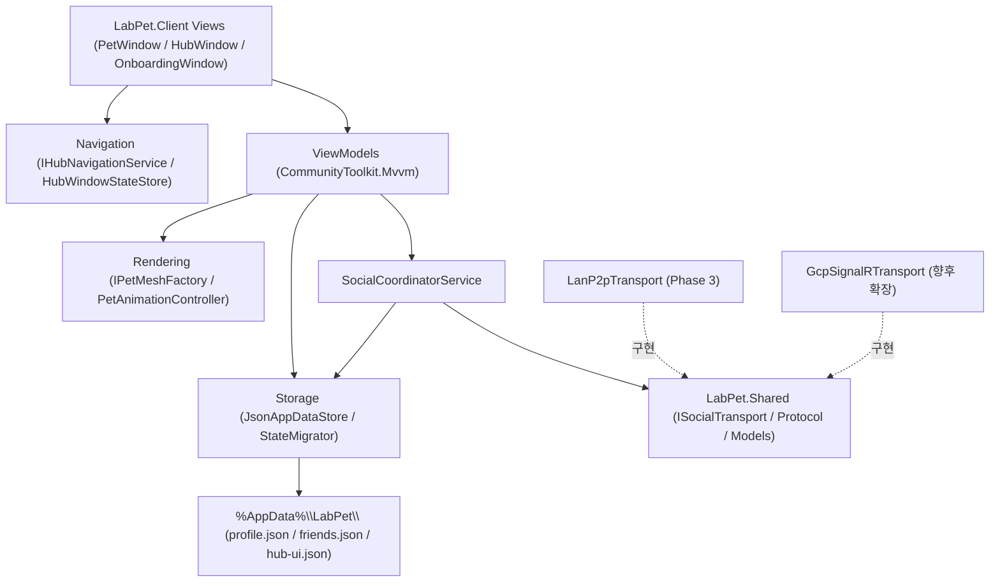

# 02. LabPet 아키텍처 설계서

## 1. 솔루션 계층 및 의존성 규칙
- `LabPet.Shared`는 WPF·네트워크 구현체·OS API에 의존하지 않는 순수 `.NET 10` 클래스 라이브러리다.
- `LabPet.Client`는 `LabPet.Shared`를 참조한다. 화면과 ViewModel은 [SocialCoordinatorService](../src/LabPet.Client/Social/SocialCoordinatorService.cs)를 사용하며, 코디네이터는 `ISocialTransport`에 의존한다.
- 추후 `LabPet.Server`(ASP.NET Core SignalR + Firestore)가 추가되면 `LabPet.Shared`를 그대로 참조해 프로토콜·모델을 공유한다.

## 2. 데이터 일관성 및 오류 처리 규칙
- **원자적 저장(Atomic Write)** 및 **스키마 v1→v2 1회성 마이그레이션**: [JsonAppDataStore.cs](../src/LabPet.Client/Storage/JsonAppDataStore.cs)는 `.tmp` 파일에 UTF-8 기록 후 `fs.Flush(true)`를 호출하고, 기존 정상 파일을 `.bak`로 복사한 뒤 `File.Move(..., overwrite: true)`로 교체한다. [StateMigrator.cs](../src/LabPet.Client/Storage/StateMigrator.cs)는 `schemaVersion < 2` 프로필을 1회 변환해 `Level=1`, `Xp=0` 및 보상 대기 카운터를 초기화하면서 기존 코인·누적 활동 통계·친구·외형·치장을 보존하고(소급 코인 지급 없음, `schemaVersion=2` 이후 재초기화 없음), `friends.json`의 친밀도를 `0~9999` 범위로 정규화한다.
- **자동 복구**: 본 파일이 손상되어 역직렬화에 실패하면 `.bak`에서 자동 복구하고, 둘 다 없을 때만 기본 프로필을 생성한다.
- **하위 호환성**: [ProtocolJson.cs](../src/LabPet.Shared/Protocol/ProtocolJson.cs)는 `JsonUnmappedMemberHandling.Skip`을 적용해 향후 상위 버전 필드가 추가되어도 역직렬화가 실패하지 않는다.
- **코인 경제·어뷰징 방지·축약 포매팅 계층**: [PetEconomyService.cs](../src/LabPet.Client/Solo/PetEconomyService.cs)가 `profile.SoloProgress` 잠금 아래 수동 코인 레벨업(`Lv.1~99`, `100 + (level - 1) * 50`), 활동/뽀모도로/일일 소셜 코인 상한(10코인, 친구·종류별 15초 쿨다운), 게임 판돈 예치/정산/환불을 원자적으로 처리한다. [GlobalActivityHookService.cs](../src/LabPet.Client/Solo/GlobalActivityHookService.cs)는 [ActivityAntiAbuseFilter.cs](../src/LabPet.Client/Solo/ActivityAntiAbuseFilter.cs)와 [SystemActivityStateMonitor.cs](../src/LabPet.Client/Solo/SystemActivityStateMonitor.cs)를 통해 주입 입력·키 홀드·오토클리커와 세션 잠금·절전·60초 이상 유휴 시간을 보상 집계에서 제외한다. UI 숫자 요약은 [CompactNumberFormatter.cs](../src/LabPet.Client/Formatting/CompactNumberFormatter.cs)가 K/M/B/T(소수 2자리, 1000 반올림 승격)로 표시하고, 정밀 수치가 필요한 레벨·친밀도·비용·잔액·부족분·정산 금액은 전체 숫자와 정확한 툴팁으로 제공한다.
- **친구 상태**는 코디네이터가 등록·보상 갱신을 짧은 잠금 안에서 처리하고, 저장 차례가 오면 최신 목록의 복사본을 저장한다. 친구 수락 응답 전에 전송 인증 목록을 갱신한다. UI에는 친구 항목 및 외형의 복사본을 넘긴다. 전송 계층의 주소·외형 갱신과 복사는 같은 친구 항목의 잠금을 사용한다. 성장 보상·수동 레벨업·코인 게임 정산은 프로필 직렬화와 같은 진행도 잠금을 사용한다.
- **단일 인스턴스**는 [App.xaml.cs](../src/LabPet.Client/App.xaml.cs)에서 생성한 뮤텍스의 소유권으로 관리한다. 소유한 인스턴스가 종료할 때 뮤텍스를 해제한다.

게임 초대 배너와 데스크톱 카드는 동작 영역의 폭을 먼저 확보한다. 가위바위보 대결과 공용 1:1 대기 뷰는 세로 스크롤을 제공하며, 가위바위보 선택·공개 표시는 공통 이모지 매핑을 사용한다. [배너](../src/LabPet.Client/Views/Hub/HubWindow.xaml), [데스크톱 카드](../src/LabPet.Client/Views/GameInviteCardWindow.xaml), [가위바위보 화면](../src/LabPet.Client/Views/Games/RpsGameView.xaml), [1:1 대기 화면](../src/LabPet.Client/Views/Games/OneToOneInviteWaitView.xaml)

## 3. 렌더링 및 동시성 원칙
- 순수 WPF `Viewport3D`와 Blender 리깅 `.glb` 스켈레톤 로더([GlbCharacterLoader.cs](../src/LabPet.Client/Rendering/GlbCharacterLoader.cs), [PetSkinInstance.cs](../src/LabPet.Client/Rendering/PetSkinInstance.cs)) → 정적 `.obj` 에셋 로더([BlenderAssetPetMeshFactory.cs](../src/LabPet.Client/Rendering/BlenderAssetPetMeshFactory.cs), [ObjMeshLoader.cs](../src/LabPet.Client/Rendering/ObjMeshLoader.cs)) → `HelixToolkit.Geometry.MeshBuilder` 폴백 팩토리([3D 메시 팩토리](../src/LabPet.Client/Rendering/ProceduralPetMeshFactory.cs)) 순의 3단계 파이프라인을 사용한다. (`RenderProbe` 검증에서 SharpDX `Viewport3DX` + GPU 스키닝은 투명 창에서 저fps·비유한 정점·종료 코드를 보여 순수 WPF `Viewport3D` + 선택적 CPU 스키닝을 유지했다.) 불변 정점·재질은 동결 후 `WeakReference`로 공유하고 변형 서브메시만 사전 할당 버퍼와 본 변경 캐시로 스키닝하며, 색상·표정 교체 시 `TryUpdateAppearance`/`UpdateColors`로 리그 재생성 없이 반영한다.
- 본체와 외형 편집은 키보드와 음악 효과를 모두 생성한다. 친구 회전 미리보기에서는 해당 효과를 생략하며, 방문 펫은 음악 효과를 생성한다. 친구 목록 갱신 중 선택 변경은 한 번에 반영하고, 친구 탭 비활성화·최소화·창 종료 시 미리보기 타이머와 리그를 정리한다. [친구 페이지](../src/LabPet.Client/Views/Hub/Pages/FriendsPageView.xaml.cs), [공용 외형 편집기](../src/LabPet.Client/Views/Controls/PetAppearanceEditorControl.xaml.cs), [방문 펫 창](../src/LabPet.Client/Views/VisitorPetWindow.xaml.cs)
- 바탕화면 펫 뷰포트는 `BitmapCache.RenderAtScale`과 고품질 축소 필터를 사용한다. 이름표 위치는 캐릭터 몸체 하단 기준점과 미니 키보드·회전 링 오라의 앞쪽 하단 기준점을 함께 뷰포트에 투영해 키보드와 오라를 가리지 않도록 계산한다. [바탕화면 펫 창](../src/LabPet.Client/Views/PetWindow.xaml.cs), [WPF 캐시 배율](https://learn.microsoft.com/dotnet/api/system.windows.media.bitmapcache.renderatscale)
- 실행 파일에는 모니터별 DPI 인식을 선언한다. 시선 추적은 화면 좌표를 각 뷰포트의 로컬 좌표로 변환한다. [앱 매니페스트](../src/LabPet.Client/app.manifest), [Windows DPI 인식](https://learn.microsoft.com/windows/win32/hidpi/setting-the-default-dpi-awareness-for-a-process)
- 상단 말풍선(업데이트 안내·친구 신청·메시지 목록)은 `PetViewport` 상단에 붙는 전용 투명 `Popup`(`SpeechBubblePopup`)으로 분리하여 메시지 생성·소멸 시 `PetWindow`의 높이나 캐릭터 위치가 변하지 않도록 한다. 창 이동·크기 변경·말풍선 높이 변화 시 팝업 위치를 즉시 재정렬한다. 게임 초대는 말풍선과 분리하여 통합 창이 닫혀 있거나 최소화되어 있으면 비활성화 경량 창([GameInviteCardWindow.xaml](../src/LabPet.Client/Views/GameInviteCardWindow.xaml), `WS_EX_NOACTIVATE`)으로 펫 주변에 표시하고, [HubWindow.xaml](../src/LabPet.Client/Views/Hub/HubWindow.xaml)이 열려 있으면 상단 슬림 배너에 표시한다. [말풍선 레이아웃](../src/LabPet.Client/Views/PetWindow.xaml), [펫 창 UI 동작](../src/LabPet.Client/Views/PetWindow.xaml.cs)
- 소셜 코디네이터는 받은 본문·발신자 이름·펫 외형을 일반 알림과 별개의 이벤트로 전달한다. 싱글톤 [펫 초상 렌더러](../src/LabPet.Client/Rendering/PetPortraitRenderer.cs)를 펫 창, 통합 관리 창(`HubViewModel` / `HomePageViewModel`), 공용 친구 선택기(`FriendInvitePicker`), 게임 허브(`CoinGamesViewModel`)가 공유해 72px 정적 초상 비트맵(LRU 상한 `MaxCachedPortraits = 32`개)을 추가 3D 렌더러 없이 재사용한다. [소셜 코디네이터](../src/LabPet.Client/Social/SocialCoordinatorService.cs)
- **통합 관리 창 (`HubWindow`) 단일 인스턴스 및 지연 생성·수명주기 관리**: [HubNavigationService.cs](../src/LabPet.Client/Navigation/HubNavigationService.cs)는 좌측 사이드바, 펫 우클릭/트레이 공용 메뉴([PetContextMenuFactory.cs](../src/LabPet.Client/Views/PetContextMenuFactory.cs)), 게임 초대 수락(`BypassUnsavedPrompt`) 경로의 화면 전환을 단일 인스턴스 [HubWindow.xaml.cs](../src/LabPet.Client/Views/Hub/HubWindow.xaml.cs)로 일원화한다(`Owner = null`, `Topmost` 상속 차단). 창 위치·크기·사이드바 접힘 상태는 [HubWindowStateStore.cs](../src/LabPet.Client/Storage/HubWindowStateStore.cs)가 `%AppData%\LabPet\hub-ui.json`에 `.tmp` → `.bak` 순서로 원자적 저장하고 다중 모니터 `VirtualScreen` 경계로 보정한다. 9개 페이지는 최초 방문 시 지연 생성(Lazy Loading)되며 `IHubPageLifecycle`을 통해 비활성·최소화 시 페이지별 갱신·3D 프리뷰 타이머를 즉시 중지한다. [GamesHubView.xaml.cs](../src/LabPet.Client/Views/Games/GamesHubView.xaml.cs)는 현재 선택된 단일 게임 `UserControl`만 동적으로 마운트하며, 창을 닫아도 싱글톤 `PomodoroTimerService`와 `CoinGamesViewModel`(진행 중인 솔로 사다리 `PendingSoloLadderSession` 포함) 진행 세션은 영속 유지된다. [게임 셸](../src/LabPet.Client/Views/Games/GamesHubView.xaml), [통합 창 ViewModel](../src/LabPet.Client/ViewModels/HubViewModel.cs)
- 3D 펫, 상단 말풍선, 친구 오버레이, 이름표와 조절바를 감싸는 요소에 프로필의 `PetOpacity`를 바인딩한다. 바탕화면 방문 친구 창([VisitorPetWindow.xaml.cs](../src/LabPet.Client/Views/VisitorPetWindow.xaml.cs))도 내 펫의 크기(`PetScale`)와 투명도(`PetOpacity`)를 실시간으로 공유한다. [펫 창 XAML](../src/LabPet.Client/Views/PetWindow.xaml)
- 친구 오버레이의 배치 영역을 전체 펫 창 크기에 맞춘다. 화면 배율에 따라 간격을 환산하고, 양옆과 위아래 배치 후보를 제공한다. [펫 창 UI 동작](../src/LabPet.Client/Views/PetWindow.xaml.cs)
- 친구 목록을 갱신할 때 펫 ID가 같은 행을 재사용한다. 진행 중인 전송이 끝나면 변경되지 않은 초안만 비워 추가로 입력한 문장을 보존한다. [펫 창 ViewModel](../src/LabPet.Client/ViewModels/PetWindowViewModel.cs)
- 친구 오버레이와 방문 펫은 빠른 메시지 입력칸과 전송 버튼을 하나의 호버 영역으로 처리한다. 포인터, 키보드 포커스, 마우스 캡처 상태와 닫기 유예 시간을 공용 코드에서 확인한다. 앱은 새 방문 펫 입력창을 열기 전에 다른 방문 펫의 입력창을 닫는다. [앱의 방문 펫 관리](../src/LabPet.Client/App.xaml.cs) [빠른 메시지 입력 동작](../src/LabPet.Client/Views/QuickMessageInputBehavior.cs)
- 방문 펫의 전송창 앵커는 실제 네임태그 경계이고 수신 말풍선 앵커는 3D 머리를 투영한 물리 화면 좌표다. 수신 말풍선은 해당 모니터 작업 영역에서 개별 배치한다. 전송창은 WPF의 화면 경계 보정 이후 실제 HWND를 네임태그 아래 중앙 좌표로 맞춘다. 앱에서 공유하는 수신 순번으로 열린 말풍선 HWND를 정렬하고 전송창을 가장 위에 둔다. 순서 변경에는 Win32의 비활성화 플래그를 적용한다. [방문 펫 창](../src/LabPet.Client/Views/VisitorPetWindow.xaml.cs), [팝업 배치 계산기](../src/LabPet.Client/Views/VisitorBubblePlacementCalculator.cs), [팝업 순서 관리](../src/LabPet.Client/Views/VisitorPopupOrder.cs)
- 인사하기(와이어 토큰 `PacketType.PetInteraction` `"pet"`)는 소셜 코디네이터의 단조 시계를 사용해 앱 전체에서 1초에 한 번 수락한다. 인사하기와 받은 빠른 반응의 상태 알림은 친구 `PetId`로 방문 펫에 우선 라우팅하고, 친밀도(`0~9999`)는 일일 소셜 코인 상한(10코인)과 독립적으로 누적된다. [소셜 코디네이터](../src/LabPet.Client/Social/SocialCoordinatorService.cs), [친구 말풍선 라우터](../src/LabPet.Client/ViewModels/FriendMessageRouter.cs)
- 친구 접속 상태는 소셜 계층의 실시간 피어 정보로 판별한다. 호버 친구 오버레이는 실시간 접속이 확인된 호환 버전의 등록 친구만 표시한다. 내 펫, 방문 펫, 친구 미리보기는 3D 수면 효과 컨트롤을 공유한다. 이미 데려온 방문 펫은 연결이 끊기면 수면 상태로 전환한다. [펫 창 ViewModel](../src/LabPet.Client/ViewModels/PetWindowViewModel.cs), [3D 수면 효과](../src/LabPet.Client/Views/SleepZzzOverlay.cs)
- 창을 복원하거나 디스플레이 구성이 바뀌면 창이 있는 모니터의 작업 영역을 물리 픽셀로 조회하고 해당 창의 DPI로 보정한다. 음수 좌표의 보조 모니터도 지원한다. [펫 창 UI 동작](../src/LabPet.Client/Views/PetWindow.xaml.cs), [Win32 창 헬퍼](../src/LabPet.Client/Interop/Win32WindowHelper.cs)
- 크기 배율 범위는 프로필에서 정의한다. 고정된 카메라와 배율에 비례하는 뷰포트 너비를 사용하고, 바탕화면 창은 말풍선과 조절바가 들어갈 최소 너비를 확보한다. [프로필](../src/LabPet.Shared/Models/PetProfile.cs), [펫 창 UI 동작](../src/LabPet.Client/Views/PetWindow.xaml.cs)
- 방문 펫의 `✕` 버튼은 리그 몸체 경계를 3D 뷰포트 좌표로 투영해 위치를 계산한다. 내 펫과 방문 펫의 발버둥은 WPF 마우스 캡처 상태를 따라 전환된다. [방문 펫 창](../src/LabPet.Client/Views/VisitorPetWindow.xaml.cs), [펫 창](../src/LabPet.Client/Views/PetWindow.xaml.cs)
- 미니게임 결과 이벤트는 내 펫 애니메이터에 연결한다. 리그에 임시 표정을 적용하고 울음의 첫 재생 때 생성한 눈물 메시를 재사용한다. 재생이 끝나면 현재 프로필에 설정된 표정으로 복원한다. [앱 이벤트 연결](../src/LabPet.Client/App.xaml.cs), [3D 모션 제어](../src/LabPet.Client/Rendering/PetAnimationController.cs)
- UI 스레드에서 `Transform3D`와 `EmissiveMaterial`을 갱신한다. 음악·타이핑·상호작용이 없으면 펫의 3D 갱신 간격을 늘린다. 호스트 음악 송출은 펫의 시각 갱신 조건과 별개로 실행한다. [펫 창 UI 동작](../src/LabPet.Client/Views/PetWindow.xaml.cs), [방문 펫 창](../src/LabPet.Client/Views/VisitorPetWindow.xaml.cs)

## 관련 문서

TCP 프레이밍·인증 응답, 수락 후 자동 키 합의, 탐색 후보 확인을 각각 분리한다. 세 게임은 공용 초대 상태 머신에서 상대 등록·수락·시작 확인을 처리한다. `GameEvent` 전송 ACK는 전달 결과로 기록하며, 상대 앱의 등록 응답이 도착하면 수락 대기로 바뀐다. 발신자가 담은 UTC 만료 시각을 양쪽에서 사용한다. 임시 참가비는 프로필에 세션 키로 보류하고 정산·환불 시 원자적 저장에 포함한다. [공용 초대 상태](../src/LabPet.Client/ViewModels/CoinGamesViewModel.Invites.cs) [TCP 제어](../src/LabPet.Client/Network/LanP2pTransport.Control.cs), [친구 등록](../src/LabPet.Client/Network/LanP2pTransport.Pairing.cs), [프레즌스](../src/LabPet.Client/Network/LanP2pTransport.Presence.cs), [가위바위보 흐름](../src/LabPet.Client/ViewModels/CoinGamesViewModel.Rps.cs)
- [01. 제품요구사항정의서](./01_제품요구사항정의서.md)
- [03. 네트워크 프로토콜 및 보안 명세](./03_네트워크_프로토콜_및_보안명세.md)
- [08-0. 기능명세서 개요 및 RTM](./08_기능명세서/08-0_기능명세서_개요.md)
