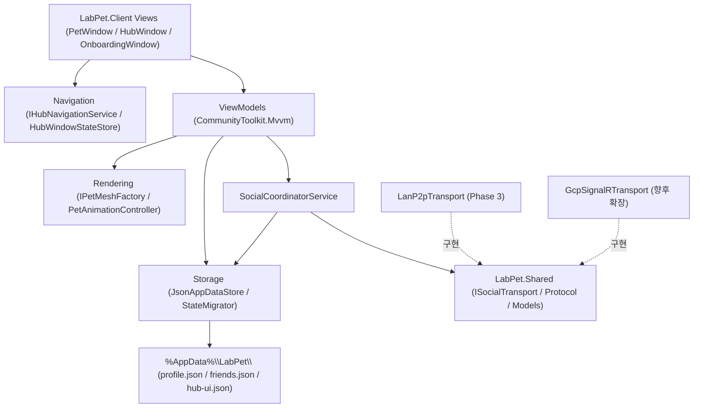

# 02. LabPet 아키텍처 설계서

## 1. 솔루션 계층 및 의존성 규칙
- `LabPet.Shared`는 WPF·네트워크 구현체·OS API에 의존하지 않는 순수 `.NET 10` 클래스 라이브러리다.
- `LabPet.Client`는 `LabPet.Shared`를 참조한다. 화면과 ViewModel은 [SocialCoordinatorService](../src/LabPet.Client/Social/SocialCoordinatorService.cs)를 사용하며, 코디네이터는 `ISocialTransport`에 의존한다.
- 추후 `LabPet.Server`(ASP.NET Core SignalR + Firestore)가 추가되면 `LabPet.Shared`를 그대로 참조해 프로토콜·모델을 공유한다.

## 2. 데이터 일관성 및 오류 처리 규칙
- **원자적 저장(Atomic Write)** 및 **스키마 v1→v2 1회성 마이그레이션**: [JsonAppDataStore.cs](../src/LabPet.Client/Storage/JsonAppDataStore.cs)는 `.tmp` 파일에 UTF-8 기록 후 `fs.Flush(true)`를 호출하고, 기존 정상 파일을 `.bak`로 복사한 뒤 `File.Move(..., overwrite: true)`로 교체한다. [StateMigrator.cs](../src/LabPet.Client/Storage/StateMigrator.cs)는 `schemaVersion < 2` 프로필을 1회 변환해 `Level=1`, `Xp=0` 및 보상 대기 카운터를 초기화하면서 기존 코인·누적 활동 통계·친구·외형·치장을 보존하고(소급 코인 지급 없음, `schemaVersion=2` 이후 재초기화 없음), `friends.json`의 친밀도를 `0~9999` 범위로 정규화한다.
- **자동 복구**: 본 파일이 손상되어 역직렬화에 실패하면 `.bak`에서 자동 복구하고, 둘 다 없을 때만 기본 프로필을 생성한다.
- **하위 호환성**: [ProtocolJson.cs](../src/LabPet.Shared/Protocol/ProtocolJson.cs)는 `JsonUnmappedMemberHandling.Skip`을 적용해 향후 상위 버전 필드가 추가되어도 역직렬화가 실패하지 않는다.
- [프로필 저장소](../src/LabPet.Client/Storage/JsonAppDataStore.cs)는 성장 상태와 펫 ID를 Windows 사용자 계정의 DPAPI 암호문에 담고, 외형 설정과 같은 원자적 프로필 스냅샷으로 저장한다. 보호 이전 표식이 있으면 평문 형식은 복구 대상으로 인정하지 않는다.
- 멀티플레이 타이핑 정산은 양쪽의 세션별 입력 기록으로 점수를 다시 계산한다. 눈던지기 발신과 인사하기 송·수신은 단조 시계로 대상별 간격을 적용한다.
- **코인 경제·어뷰징 방지·축약 포매팅 계층**: [PetEconomyService.cs](../src/LabPet.Client/Solo/PetEconomyService.cs)가 `profile.SoloProgress` 잠금 아래 수동 코인 레벨업(`Lv.1~99`, `100 + (level - 1) * 50`), 활동/뽀모도로/일일 소셜 코인 상한(10코인, 친구·종류별 15초 쿨다운), 게임 판돈 예치/정산/환불을 원자적으로 처리한다. [GlobalActivityHookService.cs](../src/LabPet.Client/Solo/GlobalActivityHookService.cs)는 [ActivityAntiAbuseFilter.cs](../src/LabPet.Client/Solo/ActivityAntiAbuseFilter.cs)와 [SystemActivityStateMonitor.cs](../src/LabPet.Client/Solo/SystemActivityStateMonitor.cs)를 통해 주입 입력·키 홀드·오토클리커와 세션 잠금·절전·60초 이상 유휴 시간을 보상 집계에서 제외한다. UI 숫자 요약은 [CompactNumberFormatter.cs](../src/LabPet.Client/Formatting/CompactNumberFormatter.cs)가 K/M/B/T(소수 2자리, 1000 반올림 승격)로 표시하고, 정밀 수치가 필요한 레벨·친밀도·비용·잔액·부족분·정산 금액은 전체 숫자와 정확한 툴팁으로 제공한다.
- **친구 상태**는 코디네이터가 등록·보상 갱신을 짧은 잠금 안에서 처리하고, 저장 차례가 오면 최신 목록의 복사본을 저장한다. 친구 수락 응답 전에 전송 인증 목록을 갱신한다. UI에는 친구 항목 및 외형의 복사본을 넘긴다. 전송 계층의 주소·외형 갱신과 복사는 같은 친구 항목의 잠금을 사용한다. 성장 보상·수동 레벨업·코인 게임 정산은 프로필 직렬화와 같은 진행도 잠금을 사용한다.
- **단일 인스턴스 및 로컬 크래시 진단**: [App.xaml.cs](../src/LabPet.Client/App.xaml.cs)에서 생성한 뮤텍스의 소유권으로 단일 인스턴스를 관리하며(종료 시 해제), UI Dispatcher·AppDomain·미관찰 태스크 예외는 [CrashLogWriter.cs](../src/LabPet.Client/Diagnostics/CrashLogWriter.cs)가 `%AppData%\LabPet\logs\crash.log`에 스택 트레이스를 기록한다(`512 KB` 초과 시 `crash.prev.log`로 로테이션). 방문 펫 말풍선 배치 실패는 로그 기록 후 해당 팝업만 닫아 앱 전체 종료로 이어지지 않도록 격리한다.

게임 초대 배너와 데스크톱 카드는 동작 영역의 폭을 먼저 확보한다. 가위바위보 대결과 공용 1:1 대기 뷰는 세로 스크롤을 제공하며, 가위바위보 선택·공개 표시는 공통 이모지 매핑을 사용한다. [배너](../src/LabPet.Client/Views/Hub/HubWindow.xaml), [데스크톱 카드](../src/LabPet.Client/Views/GameInviteCardWindow.xaml), [가위바위보 화면](../src/LabPet.Client/Views/Games/RpsGameView.xaml), [1:1 대기 화면](../src/LabPet.Client/Views/Games/OneToOneInviteWaitView.xaml)

## 눈던지기 구현 진행 상태 (2026-11-25)

### 최신 부분 구현·검증 요약

- 임시 펫은 `SnowballSpawnGeometry.TrySelect`로 화면 둘레의 연속 좌표를 최대 48회 표본 추출하여 기존 등장 영역과 겹치지 않는 위치를 우선 선택한다. 포화 시 표본 중 겹침 면적이 최소인 후보를 사용한다. 빈 공간 발견이나 전역 최적 위치를 보장하지 않는다.
- `SnowballTemporaryActor`는 진입 방향과 등장 진행률을 `PetAnimationController.SetSnowballPeek`에 전달한다. 몸통·머리·팔을 작은 각도로 보정하고 취소·리그 교체·해제 시 초기화한다. 방문 펫에는 이 입력을 적용하지 않는다.
- `SnowballPetVisual`은 손 관절의 투영 DIP를 따라 재사용 눈덩이 요소를 표시하고 발사 시 숨긴다. 발사점은 갱신된 실제 손의 물리 픽셀 좌표다.
- 최신 `SnowballOverlayWindowTests` Release 실행: 통과 39 / 실패 0 / 건너뜀 0, 9초. 네 가장자리·네 대각선의 손 투영 변화와 취소 후 복원 검사를 포함한다. 아래 단계별 숫자는 이전 실행 기록이다.
- 공용 장면·갱신 루프와 위치 분산 기반은 구현했으나 제품 수신 경로 연결은 미완료다. UI 세 위치·공유 쿨다운·지원 협상·LAN/GCP 송수신·방문 펫 재사용·실제 피격 연결 및 과부하 공정성 검토가 남아 있다.
- 실제 앱 시각 품질·LAN/GCP·다중 모니터/DPI·CPU/GPU/메모리는 미검증·미측정이다. 테스트 실행 시간은 성능 측정값이 아니다. GCP 서버와 배포 파이프라인은 변경하지 않았으며 서버 재배포 필요 여부는 미확정이다.

### 임시 펫·손 좌표·비행 연결 후속 구현

- [SnowballTemporaryActor](../src/LabPet.Client/Rendering/SnowballTemporaryActor.cs)는 발신자 한 명의 시간표·독립 관절·화면 배치를 연결한다. 동일 펫과 최초 등장 위치를 연속 투척 동안 유지하고, 마지막 명중 이후 웃음·퇴장 및 시각 리소스 정리를 수행한다. 창·비행·갱신 루프는 소유하지 않는다.
- [SnowballActorTimeline](../src/LabPet.Client/Rendering/SnowballActorTimeline.cs)은 발사 경계에서 시각 갱신을 먼저 수행한다. 발사 콜백은 갱신된 손의 물리 픽셀 좌표를 받는다. [SnowballOverlayWindow](../src/LabPet.Client/Views/SnowballOverlayWindow.cs)의 `TryLaunchPhysical`은 손·대상·포물선 높이를 장면 DIP로 변환한다. `AdvanceFlightsPhysical`은 이동한 대상을 변환하고 실제 비행 계층의 명중 ID를 반환한다.
- [오버레이 테스트](../tests/LabPet.Tests/SnowballOverlayWindowTests.cs)는 실제 WPF 창에서 1초 간격 3회·10회 투척을 실제 비행 계층에 연결하여 손의 발사점·창/펫/위치 유지·각 이벤트의 명중·최종 정리를 검사한다. 최신 해당 Release 필터는 통과 10·실패 0·건너뜀 0, 1초다. 아래 결과는 이전 단계 기록이다. 상세 명령은 [변경 이력](05_변경이력/2026-11-25.md)을 참조한다.
- **사용자 기능 통합은 미완료**다. 테스트의 이동 대상은 입력 좌표이며 실제 PetWindow·방문 펫·피격·송수신 관리자와 연결한 검증이 아니다. UI 세 위치·공유 쿨다운·지원 협상·공용 루프·위치 분산 및 실제 LAN/GCP·다중 모니터/DPI·성능 검증이 남아 있다. 코디네이터와 전송 인터페이스 읽기가 `sensitive_file`로 차단되어 해당 연결은 보류했으며 우회하지 않았다.

### 공용 비행 관리·오버레이 소유권 후속 구현

- `SnowballFlightLayer`는 하나의 Canvas에서 비행과 명중 입자 객체를 최대 24개 관리한다. 좌표는 해당 장면의 DIP만 받으며 물리 픽셀 변환은 호출자의 책임이다. 자체 타이머·창·렌더링 구독은 없다. 외부 루프가 `Advance`를 호출하고 반환된 명중 이벤트 ID를 발신자 시간표와 피격 API에 연결해야 한다. 이 연결은 아직 미완료다.
- 발신자별 취소는 해당 발신자의 비행·입자만 제거한다. Dispose는 소유 객체만 정리하고 반복 호출할 수 있다. 현재 중복 검사는 활성 비행 ID에 한정되므로 네트워크 중복 방지를 대체하지 않는다.
- `SnowballOverlayWindow.Flights`는 UI 스레드에서 지연 생성되어 같은 창 안에서 재사용된다. 창 종료 시 비행 관리 객체를 Dispose하고 종료 후 getter 접근은 거부한다. 모니터 경계·DPI 변경 시 장면 재구성과 실제 수신 관리자 연결은 후속 작업이다.
- `PetWindow.TryTriggerSnowballHit`는 현재 좌표 조회가 가능한 경우에만 기존 애니메이터의 피격 반응을 호출하고 기존 타이머를 활성 간격으로 전환한다. 실제 명중 호출 연결은 남아 있다.
- Release에서 비행 관리·오버레이 필터 7개 통과, 실패·건너뜀 0개, 521ms. 6개 동시 비행의 독립 명중, 발신자별 취소, 실제 HWND 종료 후 비행 정리와 재생성 차단을 검사했다. 실제 소셜 연출·6개 캐릭터 렌더링 성능을 검증한 것은 아니다. 명령과 이전 단계별 결과는 [변경 이력](05_변경이력/2026-11-25.md)을 참조한다.

### 명중 좌표·입자 효과 후속 구현

- `PetWindow.TryGetSnowballTargetPhysical`은 UI 스레드와 창·리그·시각 트리 상태를 검사하고 현재 몸통 중심을 뷰포트 DIP로 투영한 뒤 `PointToScreen`으로 물리 픽셀을 반환한다. 기존 창 위치·크기·네임태그는 변경하지 않는다. 실제 수신 관리자 연결 및 창 이동·배율·숨김 통합 검증은 미완료다.
- `SnowballImpactVisual`은 100 DIP 영역에서 18개 입자·눈 결정을 0.55초 동안 확산·페이드한다. 자체 창·타이머·이벤트 구독 없이 소유자의 공용 루프가 진행시키고 완료 후 제거해야 한다. 실제 명중 이벤트와 공용 관리자 연결은 남아 있다.
- `SnowballOverlayWindowTests`의 실제 WPF 비트맵 검사는 표시·페이드·완료 후 투명화·잘못된 시간 입력 무시·인스턴스 독립성을 확인했다. 해당 Release 필터는 통과 3 / 실패 0 / 건너뜀 0, 411ms다. 입자 추가 전 관련 회귀 필터 78개 통과와 별개의 실행 결과이며, 아래 29개는 이전 패킷 단계 기록이다. 취소 처리 추가 후의 35개 결과 및 실행 명령은 [변경 이력](05_변경이력/2026-11-25.md)을 참조한다.
- 전체 소셜 기능은 여전히 미연결이며 실제 화면·LAN/GCP·다중 DPI·성능 검증을 완료한 것이 아니다.

### 기존 패킷 준비 단계 기록

- **아직 사용자 기능으로 연결되지 않은 부분 구현이다.** `PetInteractionPayload`에 `pet`·`snowball` 유형 상수와 선택적 `EventId`를 추가했다. 기존 인사하기 기본값은 `pet`이며, ID가 null이면 JSON에서 생략하여 기존 와이어 본문을 유지한다. 새 ID는 LAN/GCP 경로를 바꾸거나 재전송할 때 유지할 논리 이벤트 식별자다. 실제 ID 생성·전송·중복 제거는 아직 연결되지 않았다.
- 기존 애니메이션 컨트롤러의 눈던지기 후 웃음 합성은 몸 들썩임·눈 감김과 지원되는 `happy` 표정을 사용하며 투척·드래그·게임 반응에 양보한다. 표정 미지원 모델은 몸·눈 동작으로 대체한다. 실제 화면에서 입 모양과 캐릭터별 품질은 미검증이다.
- Release에서 `SnowballProtocolTests`, `PetAnimationAndEffectTests`, `SnowballActorTimelineTests`를 실행하여 29개 통과, 실패·건너뜀 0개를 확인했다. 패킷 테스트는 기존 JSON 유지·ID 직렬화 보존·알 수 없는 유형 문자열 보존을 확인하며 실제 네트워크 수신 무시나 중복 실행 방지를 보증하지 않는다.
- 남은 연결: UI 세 위치, 대상별 공유 쿨다운, 기능지원 협상, LAN/GCP 전송·수신, 모니터별 공용 연출 관리자, 방문 펫 재사용, 모델·궤적·입자 연결. 실제 다중 모니터/DPI 및 CPU·GPU·메모리 측정도 남아 있다. `SocialCoordinatorService.cs` 읽기는 전용 도구의 `sensitive_file` 보호로 차단되어 해당 연결부는 수정하지 않았다.
- GCP 서버 수정·재배포와 배포 파이프라인 변경은 하지 않았다. 서버 재배포 필요 여부는 전송 계층 확인 후 확정한다.

## 3. 렌더링 및 동시성 원칙
- 리처드는 [원본 GLB](../src/LabPet.Client/Assets/Models/Characters/joey/model.glb)의 11개 클립과 텍스처를 [클립 재생기](../src/LabPet.Client/Rendering/AuthoredPetClips.cs)에서 읽는다. 프레임 데이터는 공유하고 재생 시간과 현재 보간된 관절 자세는 [펫별 스킨](../src/LabPet.Client/Rendering/PetSkinInstance.cs)에서 관리한다. 전환 시 현재 자세에서 다음 클립으로 0.24초 동안 크기·이동을 선형 보간하고 회전을 쿼터니언 구면 보간한 뒤 시선·타이핑 입력을 적용한다.
- 순수 WPF `Viewport3D`와 Blender 리깅 `.glb` 스켈레톤 로더([GlbCharacterLoader.cs](../src/LabPet.Client/Rendering/GlbCharacterLoader.cs), [PetSkinInstance.cs](../src/LabPet.Client/Rendering/PetSkinInstance.cs)) → 정적 `.obj` 에셋 로더([BlenderAssetPetMeshFactory.cs](../src/LabPet.Client/Rendering/BlenderAssetPetMeshFactory.cs), [ObjMeshLoader.cs](../src/LabPet.Client/Rendering/ObjMeshLoader.cs)) → `HelixToolkit.Geometry.MeshBuilder` 폴백 팩토리([3D 메시 팩토리](../src/LabPet.Client/Rendering/ProceduralPetMeshFactory.cs)) 순의 3단계 파이프라인을 사용한다. (`RenderProbe` 검증에서 SharpDX `Viewport3DX` + GPU 스키닝은 투명 창에서 저fps·비유한 정점·종료 코드를 보여 순수 WPF `Viewport3D` + 선택적 CPU 스키닝을 유지했다.) 불변 정점·재질은 동결 후 `WeakReference`로 공유하고 변형 서브메시만 사전 할당 버퍼와 본 변경 캐시로 스키닝하며, 색상·표정 교체 시 `TryUpdateAppearance`/`UpdateColors`로 리그 재생성 없이 반영한다.
- 본체와 외형 편집은 키보드와 음악 효과를 모두 생성한다. 친구 회전 미리보기에서는 해당 효과를 생략하며, 방문 펫은 음악 효과를 생성한다. 친구 목록 갱신 중 선택 변경은 한 번에 반영하고, 친구 탭 비활성화·최소화·창 종료 시 미리보기 타이머와 리그를 정리한다. [친구 페이지](../src/LabPet.Client/Views/Hub/Pages/FriendsPageView.xaml.cs), [공용 외형 편집기](../src/LabPet.Client/Views/Controls/PetAppearanceEditorControl.xaml.cs), [방문 펫 창](../src/LabPet.Client/Views/VisitorPetWindow.xaml.cs)
- 바탕화면 펫 뷰포트는 `BitmapCache.RenderAtScale`과 고품질 축소 필터를 사용한다. 이름표 위치는 캐릭터 몸체 하단 기준점과 미니 키보드·회전 링 오라의 앞쪽 하단 기준점을 함께 뷰포트에 투영해 키보드와 오라를 가리지 않도록 계산한다. [바탕화면 펫 창](../src/LabPet.Client/Views/PetWindow.xaml.cs), [WPF 캐시 배율](https://learn.microsoft.com/dotnet/api/system.windows.media.bitmapcache.renderatscale)
- 실행 파일에는 모니터별 DPI 인식을 선언한다. 시선 추적은 화면 좌표를 각 뷰포트의 로컬 좌표로 변환한다. [앱 매니페스트](../src/LabPet.Client/app.manifest), [Windows DPI 인식](https://learn.microsoft.com/windows/win32/hidpi/setting-the-default-dpi-awareness-for-a-process)
- 상단 말풍선(업데이트 안내·친구 신청·메시지 목록)은 `PetViewport` 상단에 붙는 전용 투명 `Popup`(`SpeechBubblePopup`)으로 분리하여 메시지 생성·소멸 시 `PetWindow`의 높이나 캐릭터 위치가 변하지 않도록 한다. 창 이동·크기 변경·말풍선 높이 변화 시 팝업 위치를 즉시 재정렬한다. 게임 초대는 [HubWindow.xaml](../src/LabPet.Client/Views/Hub/HubWindow.xaml)의 상단 배너와 독립 비활성화 카드 창에 동시에 표시한다. [카드 표시 관리](../src/LabPet.Client/Views/GameInviteCardPresenter.cs)는 초대 상태에 맞춰 카드 한 개를 유지하고, 펫의 말풍선 경계와 겹치면 옆으로 배치한다. [말풍선 레이아웃](../src/LabPet.Client/Views/PetWindow.xaml), [펫 창 UI 동작](../src/LabPet.Client/Views/PetWindow.xaml.cs)
- [업데이트 서비스](../src/LabPet.Client/Updates/UpdateService.cs)가 확인·다운로드·적용 예약을 직렬화하고 펫 말풍선과 정보 페이지에 같은 버전·상태를 전달한다. 적용 예약에 성공하면 [앱 종료 경로](../src/LabPet.Client/App.xaml.cs)에서 저장 작업과 서비스 정리를 마친 뒤 Velopack이 앱을 다시 시작한다.
- 소셜 코디네이터는 받은 본문·발신자 이름·펫 외형을 일반 알림과 별개의 이벤트로 전달한다. 싱글톤 [펫 초상 렌더러](../src/LabPet.Client/Rendering/PetPortraitRenderer.cs)를 펫 창, 통합 관리 창(`HubViewModel` / `HomePageViewModel`), 공용 친구 선택기(`FriendInvitePicker`), 게임 허브(`CoinGamesViewModel`)가 공유해 72px 정적 초상 비트맵(LRU 상한 `MaxCachedPortraits = 32`개)을 추가 3D 렌더러 없이 재사용한다. [소셜 코디네이터](../src/LabPet.Client/Social/SocialCoordinatorService.cs)
- **통합 관리 창 (`HubWindow`) 단일 인스턴스 및 지연 생성·수명주기 관리**: [HubNavigationService.cs](../src/LabPet.Client/Navigation/HubNavigationService.cs)는 좌측 사이드바, 펫 우클릭/트레이 공용 메뉴([PetContextMenuFactory.cs](../src/LabPet.Client/Views/PetContextMenuFactory.cs)), 게임 초대 수락(`BypassUnsavedPrompt`) 경로의 화면 전환을 단일 인스턴스 [HubWindow.xaml.cs](../src/LabPet.Client/Views/Hub/HubWindow.xaml.cs)로 일원화한다(`Owner = null`, `Topmost` 상속 차단). 창 위치·크기·사이드바 접힘 상태는 [HubWindowStateStore.cs](../src/LabPet.Client/Storage/HubWindowStateStore.cs)가 `%AppData%\LabPet\hub-ui.json`에 `.tmp` → `.bak` 순서로 원자적 저장하고 다중 모니터 `VirtualScreen` 경계로 보정한다. 9개 페이지는 최초 방문 시 지연 생성(Lazy Loading)되며 `IHubPageLifecycle`을 통해 비활성·최소화 시 페이지별 갱신·3D 프리뷰 타이머를 즉시 중지한다. [GamesHubView.xaml.cs](../src/LabPet.Client/Views/Games/GamesHubView.xaml.cs)는 현재 선택된 단일 게임 `UserControl`만 동적으로 마운트하며, 창을 닫아도 싱글톤 `PomodoroTimerService`와 `CoinGamesViewModel`(진행 중인 솔로 사다리 `PendingSoloLadderSession` 포함) 진행 세션은 영속 유지된다. [게임 셸](../src/LabPet.Client/Views/Games/GamesHubView.xaml), [통합 창 ViewModel](../src/LabPet.Client/ViewModels/HubViewModel.cs)
- [뽀모도로 페이지](../src/LabPet.Client/Views/Hub/Pages/PomodoroPageView.xaml.cs)는 설정 목표를 즉시 반영하고 화면에 그릴 비율을 별도로 보간한다. 원호와 핸들은 같은 표시 비율과 [공용 다이얼 계산](../src/LabPet.Client/Solo/PomodoroCircularDialMath.cs)을 사용한다. 드래그 또는 페이지 비활성화 시에는 표시 비율을 목표에 맞춘다.
- 3D 펫, 상단 말풍선, 친구 오버레이, 이름표와 조절바를 감싸는 요소에 프로필의 `PetOpacity`를 바인딩한다. 바탕화면 방문 친구 창([VisitorPetWindow.xaml.cs](../src/LabPet.Client/Views/VisitorPetWindow.xaml.cs))도 내 펫의 크기(`PetScale`)와 투명도(`PetOpacity`)를 실시간으로 공유한다. [펫 창 XAML](../src/LabPet.Client/Views/PetWindow.xaml)
- 친구 오버레이의 배치 영역을 전체 펫 창 크기에 맞춘다. 화면 배율에 따라 간격을 환산하고, 양옆과 위아래 배치 후보를 제공한다. [펫 창 UI 동작](../src/LabPet.Client/Views/PetWindow.xaml.cs)
- 친구 목록을 갱신할 때 펫 ID가 같은 행을 재사용한다. 진행 중인 전송이 끝나면 변경되지 않은 초안만 비워 추가로 입력한 문장을 보존한다. [펫 창 ViewModel](../src/LabPet.Client/ViewModels/PetWindowViewModel.cs)
- 친구 오버레이와 방문 펫은 빠른 메시지 입력칸과 전송 버튼을 하나의 호버 영역으로 처리한다. 포인터, 키보드 포커스, 마우스 캡처 상태와 닫기 유예 시간을 공용 코드에서 확인한다. 앱은 새 방문 펫 입력창을 열기 전에 다른 방문 펫의 입력창을 닫는다. [앱의 방문 펫 관리](../src/LabPet.Client/App.xaml.cs) [빠른 메시지 입력 동작](../src/LabPet.Client/Views/QuickMessageInputBehavior.cs)
- 방문 펫의 전송창 앵커는 실제 네임태그 경계이고 수신 말풍선 앵커는 3D 머리를 투영한 물리 화면 좌표다. 수신 말풍선은 해당 모니터 작업 영역에서 개별 배치하며, 닫힌 `PopupRoot`의 레이아웃 중단 상태를 피하기 위해 팝업을 연 상태에서 가시 카드 전체를 무효화·재측정한 뒤 좌표와 크기를 확정한다. 전송창은 WPF의 화면 경계 보정 이후 실제 유효 HWND(`IsWindow`)를 네임태그 아래 중앙 좌표로 맞춘다. 앱에서 공유하는 수신 순번으로 열린 말풍선 HWND를 정렬하고 전송창을 가장 위에 둔다. 순서 변경에는 Win32의 비활성화 플래그를 적용한다. [방문 펫 창](../src/LabPet.Client/Views/VisitorPetWindow.xaml.cs), [팝업 배치 계산기](../src/LabPet.Client/Views/VisitorBubblePlacementCalculator.cs), [팝업 순서 관리](../src/LabPet.Client/Views/VisitorPopupOrder.cs)
- 인사하기(와이어 토큰 `PacketType.PetInteraction` `"pet"`)는 소셜 코디네이터의 단조 시계를 사용해 앱 전체에서 1초에 한 번 수락한다. 인사하기와 받은 빠른 반응의 상태 알림은 친구 `PetId`로 방문 펫에 우선 라우팅하고, 친밀도(`0~9999`)는 일일 소셜 코인 상한(10코인)과 독립적으로 누적된다. [소셜 코디네이터](../src/LabPet.Client/Social/SocialCoordinatorService.cs), [친구 말풍선 라우터](../src/LabPet.Client/ViewModels/FriendMessageRouter.cs)
- 친구 접속 상태는 소셜 계층의 실시간 피어 정보로 판별한다. 호버 친구 오버레이는 실시간 접속이 확인된 호환 버전의 등록 친구만 표시한다. 내 펫, 방문 펫, 친구 미리보기와 친구 목록의 미니 표시가 한 수면 글자 컨트롤을 공유한다. 화면에 보이는 동안에만 WPF 스토리보드를 재생하며 친구 행에는 20×16 DIP 변형을 사용한다. 이미 데려온 방문 펫은 연결이 끊기면 수면 상태로 전환한다. [펫 창 ViewModel](../src/LabPet.Client/ViewModels/PetWindowViewModel.cs), [3D 수면 효과](../src/LabPet.Client/Views/SleepZzzOverlay.cs)
- 창을 복원하거나 디스플레이 구성이 바뀌면 창이 있는 모니터의 작업 영역을 물리 픽셀로 조회하고 해당 창의 DPI로 보정한다. 음수 좌표의 보조 모니터도 지원한다. [펫 창 UI 동작](../src/LabPet.Client/Views/PetWindow.xaml.cs), [Win32 창 헬퍼](../src/LabPet.Client/Interop/Win32WindowHelper.cs)
- 크기 배율 범위는 프로필에서 정의한다. 고정된 카메라와 배율에 비례하는 뷰포트 너비를 사용하고, 바탕화면 창은 말풍선과 조절바가 들어갈 최소 너비를 확보한다. [프로필](../src/LabPet.Shared/Models/PetProfile.cs), [펫 창 UI 동작](../src/LabPet.Client/Views/PetWindow.xaml.cs)
- 방문 펫의 `✕` 버튼은 리그 몸체 경계를 3D 뷰포트 좌표로 투영해 위치를 계산한다. 내 펫과 방문 펫의 발버둥은 WPF 마우스 캡처 상태를 따라 전환된다. [방문 펫 창](../src/LabPet.Client/Views/VisitorPetWindow.xaml.cs), [펫 창](../src/LabPet.Client/Views/PetWindow.xaml.cs)
- 미니게임 결과 이벤트는 내 펫 애니메이터에 연결한다. 리그에 임시 표정을 적용하고 울음의 첫 재생 때 생성한 눈물 메시를 재사용한다. 재생이 끝나면 현재 프로필에 설정된 표정으로 복원한다. [앱 이벤트 연결](../src/LabPet.Client/App.xaml.cs), [3D 모션 제어](../src/LabPet.Client/Rendering/PetAnimationController.cs)
- UI 스레드에서 `Transform3D`와 `EmissiveMaterial`을 갱신한다. 음악·타이핑·상호작용이 없으면 펫의 3D 갱신 간격을 늘린다. 호스트 음악 송출은 펫의 시각 갱신 조건과 별개로 실행한다. [펫 창 UI 동작](../src/LabPet.Client/Views/PetWindow.xaml.cs), [방문 펫 창](../src/LabPet.Client/Views/VisitorPetWindow.xaml.cs)

소셜 및 저장 서비스는 종료 진입 시 신규 작업을 닫고 이미 시작된 저장과 이벤트 처리를 기다린다. LAN과 SignalR은 종료 토큰으로 백그라운드 프레즌스·재연결 작업을 취소하고 다음 시작 전에 정리를 마친다. [서비스 종료 동기화](../src/LabPet.Client/AsyncOperationLifetime.cs), [Windows 배포 검증](배포_운영_가이드.md)

## 눈덩이 공용 장면 갱신 기반 (앱 통합 미완료)

- `SnowballSceneController`는 하나의 `SnowballOverlayWindow`에서 기본 최대 6명 임시 actor와 독립 비행·명중을 관리한다. 성공한 등록만 소유하며 다른 창의 actor 및 발신자 중복을 거부한다.
- `SnowballSceneLoop`는 동일 창의 장면에 하나만 연결된다. 수락 후 `Wake()`를 호출하면 `CompositionTarget.Rendering`에서 Stopwatch 단조시간과 대상의 물리 좌표로 장면을 갱신한다. 장면 `HasWork`는 actor와 명중 후 입자를 포함한 비행 계층을 확인하며, 조회로 새 계층을 만들지 않는다.
- 유휴 시 Rendering 구독을 해제한다. 창·장면 종료 시 즉시 루프를 해제하고, 루프 Dispose는 장면 연결만 해제하므로 장면 자체는 호출자가 정리한다. 대상 소실 또는 갱신 예외는 해당 장면을 종료하며 예외는 기존 CrashLogWriter에 기록한다.
- `SnowballSceneController.Pending`은 최대 12명·발신자별 1건의 FIFO 대기열을 관리하며 TimeProvider 단조시간으로 4초 후 만료한다. 슬롯 확보 후에만 actor를 생성하고 생성 전후 취소·만료·종료를 재검증한다. 대기자가 있을 때 기존 actor의 신규 연장 요청은 TryReceive·TryEnqueue 모두 false로 거부하여 슬롯 독점을 제한한다. 이미 수락한 후속 투척과 발사된 비행은 취소하지 않고 마친 뒤 대기자를 FIFO로 입장시킨다. 최대 actor 1에서 이 보존·진입·명중·정리 동작의 회귀 테스트를 추가했으며 SnowballOverlayWindowTests 실제 Release 결과는 통과 40 / 실패 0 / 건너뜀 0(9초)이다. 아래 31개 결과는 이전 단계 기록이다. 이 정책은 네트워크의 발신자별 1초 제한과 별개이며, 정상 부하의 다중 발신자 연속 수락 및 제품 송수신 통합은 추가 검증해야 한다.
- `SnowballSpawnGeometry.TrySelect`는 화면 둘레의 연속 무작위 좌표를 최대 48회 평가한다. 기존 actor의 점유 영역과 겹치지 않는 후보를 우선하고 포화 시 표본 중 최소 겹침 후보를 사용한다. `TrySelectSpawn`은 기존 actor를 이동시키지 않는다. 전역 최적 위치나 모든 빈자리 발견을 보장하지 않는다.
- `SnowballPetVisual.SetSnowballHeld`는 독립 리그의 실제 손 관절을 로컬 DIP로 투영해 재사용 2D 눈덩이를 배치한다. `SnowballTemporaryActor`가 관절·레이아웃 갱신 후 투척 준비 중 표시하고 발사 순간 숨긴다. 추가 창·타이머 없이 동작하며 Dispose에서 표시·자식·참조를 정리한다.
- `SnowballOverlayWindowTests` 실제 Release 결과는 통과 31 / 실패 0 / 건너뜀 0(8초)이다. 기존 루프 검증에 대기열·생성 실패·재진입, 위치 분산과 손 표시 추적·분리·정리를 포함한다. 독립 WPF 장면 검증이며 UI 세 위치·공유 대상별 쿨다운·지원 협상·송수신·방문 펫 재사용·실제 피격·방향별 자세 및 제품 수신 경로 연결은 미완료다. 성능·LAN/GCP·다중 DPI 실환경은 미검증이며 서버와 배포 구조 변경은 없다.

## 관련 문서

TCP 프레이밍·인증 응답, 수락 후 자동 키 합의, 탐색 후보 확인을 각각 분리한다. 세 게임은 공용 초대 상태 머신에서 상대 등록·수락·시작 확인을 처리한다. `GameEvent` 전송 ACK는 전달 결과로 기록하며, 상대 앱의 등록 응답이 도착하면 수락 대기로 바뀐다. 발신자가 담은 UTC 만료 시각을 양쪽에서 사용한다. 임시 참가비는 프로필에 세션 키로 보류하고 정산·환불 시 원자적 저장에 포함한다. [공용 초대 상태](../src/LabPet.Client/ViewModels/CoinGamesViewModel.Invites.cs) [TCP 제어](../src/LabPet.Client/Network/LanP2pTransport.Control.cs), [친구 등록](../src/LabPet.Client/Network/LanP2pTransport.Pairing.cs), [프레즌스](../src/LabPet.Client/Network/LanP2pTransport.Presence.cs), [가위바위보 흐름](../src/LabPet.Client/ViewModels/CoinGamesViewModel.Rps.cs)
- [01. 제품요구사항정의서](./01_제품요구사항정의서.md)
- [03. 네트워크 프로토콜 및 보안 명세](./03_네트워크_프로토콜_및_보안명세.md)
- [08-0. 기능명세서 개요 및 RTM](./08_기능명세서/08-0_기능명세서_개요.md)

인증된 이벤트를 받는 [데스크톱 눈덩이 장면](../src/LabPet.Client/Views/SnowballDesktopScene.cs)은 내 펫이 있는 모니터에 공용 창을 열고, 기존 방문 펫 리그 또는 발신 외형을 사용한 임시 펫을 선택한다. [눈던지기 서비스](../src/LabPet.Client/Social/SnowballInteractionService.cs)가 세 버튼에 대상별 발신 상태를 공유한다. LAN 및 GCP 전송은 기존 암호화 `PetInteraction`에서 눈던지기를 구분하고 검증한 이벤트를 장면에 전달한다.

송신 서비스는 전송 전에 대기 슬롯을 확보한다. 네트워크 호출은 병렬로 진행하며, 성공한 요청은 전송 시도 순서대로 [송신 시간표](../src/LabPet.Client/Rendering/SnowballOutgoingTimeline.cs)에 전달한다. 내 펫의 단일 리그가 투척 자세를 제어하고, 발사한 눈덩이는 [공용 비행 계층](../src/LabPet.Client/Rendering/SnowballFlightLayer.cs)에서 각자의 실제 화면 좌표를 추적한다. 렌더링 루프는 기존 수신 장면과 공유하며 출력에 필요한 모니터별 투과 창을 재사용한다.

[임시 펫](../src/LabPet.Client/Rendering/SnowballTemporaryActor.cs)은 움직이는 몸통 투영과 모니터 클리핑 영역의 교차점에서 조준점을 제공한다. 준비 중인 투척과 이미 발사한 눈덩이가 퇴장을 제한적으로 보류할 수 있다. 정식 방문 펫이 열리면 임시 리그를 해제하고, 기존 수신 시간표와 송신 눈덩이의 추적 목표를 방문 펫으로 넘긴다.

방문 펫 말풍선의 본문은 물리 픽셀 반올림을 고려해 모니터 작업영역 가장자리에서 여백 1픽셀을 확보한다. 꼬리는 실제 머리 좌표를 사용한다.
