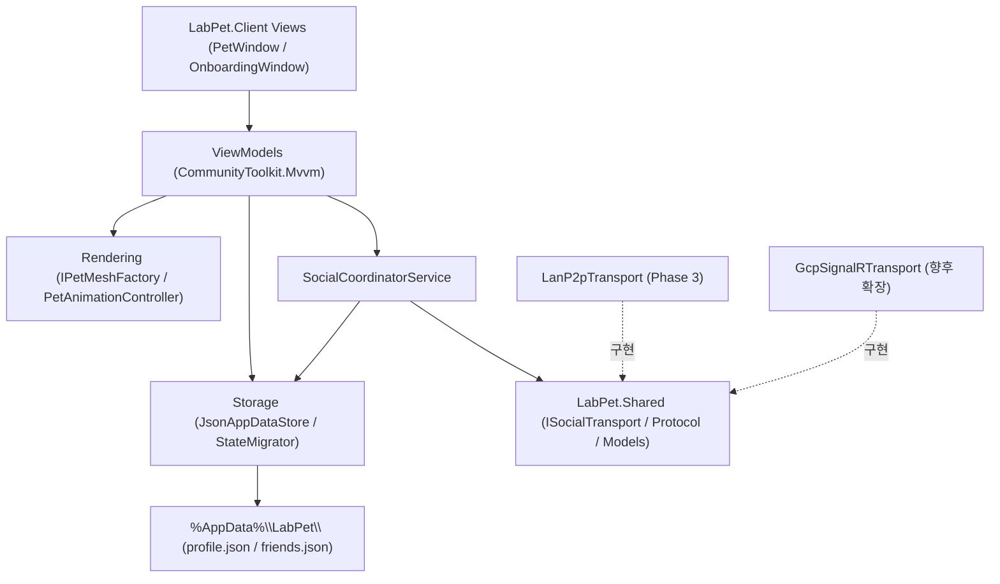

# 02. LabPet 아키텍처 설계서

## 1. 솔루션 계층 및 의존성 규칙
- `LabPet.Shared`는 WPF·네트워크 구현체·OS API에 의존하지 않는 순수 `.NET 10` 클래스 라이브러리다.
- `LabPet.Client`는 `LabPet.Shared`를 참조한다. 화면과 ViewModel은 [SocialCoordinatorService](../src/LabPet.Client/Social/SocialCoordinatorService.cs)를 사용하며, 코디네이터는 `ISocialTransport`에 의존한다.
- 추후 `LabPet.Server`(ASP.NET Core SignalR + Firestore)가 추가되면 `LabPet.Shared`를 그대로 참조해 프로토콜·모델을 공유한다.

## 2. 데이터 일관성 및 오류 처리 규칙
- **원자적 저장(Atomic Write)**: [JsonAppDataStore.cs](../src/LabPet.Client/Storage/JsonAppDataStore.cs)는 `.tmp` 파일에 UTF-8 기록 후 `fs.Flush(true)`를 호출하고, 기존 정상 파일을 `.bak`로 복사한 뒤 `File.Move(..., overwrite: true)`로 교체한다.
- **자동 복구**: 본 파일이 손상되어 역직렬화에 실패하면 `.bak`에서 자동 복구하고, 둘 다 없을 때만 기본 프로필을 생성한다.
- **하위 호환성**: [ProtocolJson.cs](../src/LabPet.Shared/Protocol/ProtocolJson.cs)는 `JsonUnmappedMemberHandling.Skip`을 적용해 향후 상위 버전 필드가 추가되어도 역직렬화가 실패하지 않는다.
- **친구 상태**는 코디네이터가 등록·보상 갱신을 짧은 잠금 안에서 처리하고, 저장 차례가 오면 최신 목록의 복사본을 저장한다. 친구 수락 응답 전에 전송 인증 목록을 갱신한다. UI에는 친구 항목 및 외형의 복사본을 넘긴다. 전송 계층의 주소·외형 갱신과 복사는 같은 친구 항목의 잠금을 사용한다. 성장 보상과 상점 구매는 프로필 직렬화와 같은 진행도 잠금을 사용한다.
- **단일 인스턴스**는 [App.xaml.cs](../src/LabPet.Client/App.xaml.cs)에서 생성한 뮤텍스의 소유권으로 관리한다. 소유한 인스턴스가 종료할 때 뮤텍스를 해제한다.

## 3. 렌더링 및 동시성 원칙
- 순수 WPF `Viewport3D`와 `HelixToolkit.Geometry.MeshBuilder`를 사용한다. 정점·법선·인덱스가 모두 같은 `MeshGeometry3D`를 동결해 여러 장면에서 공유한다. 공유 캐시는 메시를 약한 참조로 보관하며 최대 256개 항목을 유지한다. 재질·변환·애니메이션은 장면별로 생성한다. [3D 메시 팩토리](../src/LabPet.Client/Rendering/ProceduralPetMeshFactory.cs)
- 본체와 외형 편집은 키보드와 음악 효과를 모두 생성한다. 친구 회전 미리보기에서는 해당 효과를 생략하며, 방문 펫은 음악 효과를 생성한다. 친구 목록 갱신 중 선택 변경은 한 번에 반영하고 선택이 해제되거나 창을 닫으면 미리보기 리그를 해제한다. [친구 창](../src/LabPet.Client/Views/SocialWindow.xaml.cs), [방문 펫 창](../src/LabPet.Client/Views/VisitorPetWindow.xaml.cs)
- 바탕화면 펫 뷰포트는 `BitmapCache.RenderAtScale`과 고품질 축소 필터를 사용한다. 이름표 위치는 메시 하단의 기준점을 뷰포트에 투영해 모델이나 창 크기가 바뀔 때 계산한다. [바탕화면 펫 창](../src/LabPet.Client/Views/PetWindow.xaml.cs), [WPF 캐시 배율](https://learn.microsoft.com/dotnet/api/system.windows.media.bitmapcache.renderatscale)
- 실행 파일에는 모니터별 DPI 인식을 선언한다. 시선 추적은 화면 좌표를 각 뷰포트의 로컬 좌표로 변환한다. [앱 매니페스트](../src/LabPet.Client/app.manifest), [Windows DPI 인식](https://learn.microsoft.com/windows/win32/hidpi/setting-the-default-dpi-awareness-for-a-process)
- 상단 말풍선은 내용 높이를 사용한다. 높이 변화 시 창 아래쪽을 기준으로 배치하고, 위치를 저장할 때 기본 영역을 넘은 말풍선 높이를 보정한다. [말풍선 레이아웃](../src/LabPet.Client/Views/PetWindow.xaml)
- 3D 펫, 상단 말풍선 영역, 친구 오버레이에 프로필의 `PetOpacity`를 각각 바인딩한다. 빠른 메시지 입력창은 오버레이의 투명도를 적용받는다. [펫 창 XAML](../src/LabPet.Client/Views/PetWindow.xaml)
- 친구 목록을 갱신할 때 펫 ID가 같은 행을 재사용한다. 진행 중인 전송이 끝나면 변경되지 않은 초안만 비워 추가로 입력한 문장을 보존한다. [펫 창 ViewModel](../src/LabPet.Client/ViewModels/PetWindowViewModel.cs)
- 창을 복원할 때 외형 조절바까지 작업 영역에 들어오도록 하단 위치를 보정한다. [펫 창 UI 동작](../src/LabPet.Client/Views/PetWindow.xaml.cs)
- 크기 배율 범위는 프로필에서 정의한다. 고정된 카메라와 배율에 비례하는 뷰포트 너비를 사용하고, 바탕화면 창은 말풍선과 조절바가 들어갈 최소 너비를 확보한다. [프로필](../src/LabPet.Shared/Models/PetProfile.cs), [펫 창 UI 동작](../src/LabPet.Client/Views/PetWindow.xaml.cs)
- UI 스레드의 60fps `DispatcherTimer`가 `Transform3D`와 `EmissiveMaterial`만 갱신하고, 백그라운드 스레드(오디오/네트워크)는 `volatile` 스냅샷 필드로만 값을 전달한다.

## 관련 문서
- [01. 제품요구사항정의서](./01_제품요구사항정의서.md)
- [03. 네트워크 프로토콜 및 보안 명세](./03_네트워크_프로토콜_및_보안명세.md)
- [08-0. 기능명세서 개요 및 RTM](./08_기능명세서/08-0_기능명세서_개요.md)
