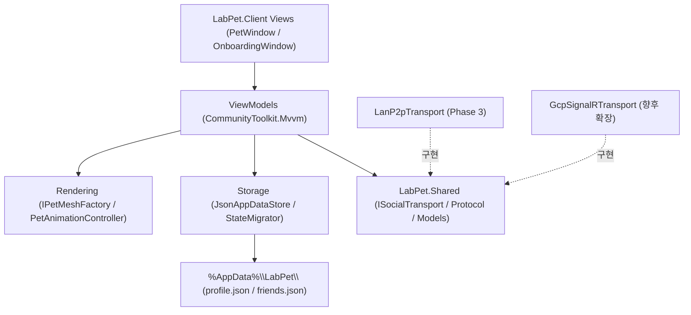

# 02. LabPet 아키텍처 설계서

## 1. 솔루션 계층 및 의존성 규칙
- `LabPet.Shared`는 WPF·네트워크 구현체·OS API에 의존하지 않는 순수 `.NET 10` 클래스 라이브러리다.
- `LabPet.Client`는 `LabPet.Shared`를 참조하며, 모든 ViewModel은 소셜 전송 구현체가 아닌 `ISocialTransport` 인터페이스만 의존한다.
- 추후 `LabPet.Server`(ASP.NET Core SignalR + Firestore)가 추가되면 `LabPet.Shared`를 그대로 참조해 프로토콜·모델을 공유한다.

## 2. 데이터 일관성 및 오류 처리 규칙
- **원자적 저장(Atomic Write)**: [JsonAppDataStore.cs](../src/LabPet.Client/Storage/JsonAppDataStore.cs)는 `.tmp` 파일에 UTF-8 기록 후 `fs.Flush(true)`를 호출하고, 기존 정상 파일을 `.bak`로 복사한 뒤 `File.Move(..., overwrite: true)`로 교체한다.
- **자동 복구**: 본 파일이 손상되어 역직렬화에 실패하면 `.bak`에서 자동 복구하고, 둘 다 없을 때만 기본 프로필을 생성한다.
- **하위 호환성**: [ProtocolJson.cs](../src/LabPet.Shared/Protocol/ProtocolJson.cs)는 `JsonUnmappedMemberHandling.Skip`을 적용해 향후 상위 버전 필드가 추가되어도 역직렬화가 실패하지 않는다.

## 3. 렌더링 및 동시성 원칙
- 순수 WPF `Viewport3D` + `HelixToolkit.Geometry.MeshBuilder` 기반 메시를 Freeze해 GPU 메모리 재할당을 줄인다.
- UI 스레드의 60fps `DispatcherTimer`가 `Transform3D`와 `EmissiveMaterial`만 갱신하고, 백그라운드 스레드(오디오/네트워크)는 `volatile` 스냅샷 필드로만 값을 전달한다.

## 관련 문서
- [01. 제품요구사항정의서](./01_제품요구사항정의서.md)
- [03. 네트워크 프로토콜 및 보안 명세](./03_네트워크_프로토콜_및_보안명세.md)
- [08-0. 기능명세서 개요 및 RTM](./08_기능명세서/08-0_기능명세서_개요.md)
