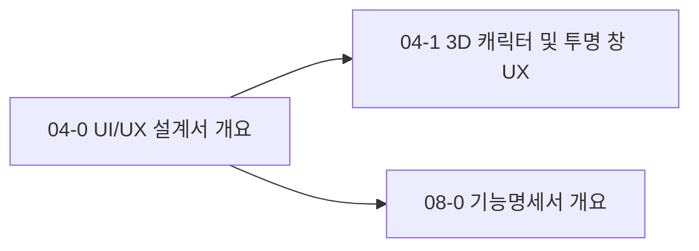

# 04-0. UI/UX 설계서 개요

## 기준선
| 항목 | 내용 |
| --- | --- |
| 기준선 | 통합 관리 창(`HubWindow`) Win11 디자인 개편 및 단일 내비게이션 적용 |
| 렌더링 기반 | WPF `Viewport3D` + `HelixToolkit.Wpf 3.1.2` (`AllowsTransparency="True"`) + [HubDesignSystem.xaml](../../src/LabPet.Client/Themes/HubDesignSystem.xaml) |
| 트레이 · 우클릭 메뉴 | `H.NotifyIcon.Wpf 2.3.0` + [PetContextMenuFactory.cs](../../src/LabPet.Client/Views/PetContextMenuFactory.cs) |

## 문서 맵

## 화면 인벤토리
| 화면 ID | XAML 파일 | 역할 |
| --- | --- | --- |
| `SCR-01` | [OnboardingWindow.xaml](../../src/LabPet.Client/Views/OnboardingWindow.xaml) | 최초 실행 온보딩 마법사 (공용 [PetAppearanceEditorControl.xaml](../../src/LabPet.Client/Views/Controls/PetAppearanceEditorControl.xaml) 호스팅) |
| `SCR-02` | [PetWindow.xaml](../../src/LabPet.Client/Views/PetWindow.xaml) | 바탕화면 상주 투명 3D 펫 창, 상단 말풍선 `Popup`, 친구 오버레이, 우클릭·트레이 공용 메뉴 |
| `SCR-03` | [HubWindow.xaml](../../src/LabPet.Client/Views/Hub/HubWindow.xaml) | 단일 인스턴스 통합 관리 창 (접힘 가능 좌측 사이드바, 48 DIP 공용 헤더, 상단 슬림 초대 배너, 8방향 리사이즈, `hub-ui.json` 위치/크기 복원) |
| `SCR-03A` | [HomePageView.xaml](../../src/LabPet.Client/Views/Hub/Pages/HomePageView.xaml) | 홈 대시보드 (프로필·수동 코인 레벨 진행 바·축약 보유 코인·온라인 친구·뽀모도로·축약 누적 활동량·연결 상태 요약 및 빠른 실행) |
| `SCR-03B` | [AppearancePageView.xaml](../../src/LabPet.Client/Views/Hub/Pages/AppearancePageView.xaml) | 외형·이름·크기·투명도 편집 (공용 `PetAppearanceEditorControl`, 미저장 이탈 가드 `IHubUnsavedChangesGuard`) |
| `SCR-03C` | [FriendsPageView.xaml](../../src/LabPet.Client/Views/Hub/Pages/FriendsPageView.xaml) | 내 친구 3D 프리뷰(친밀도 `0~9999` / `친밀도 MAX` + 정확한 값 툴팁) · 말풍선 · 인사하기 · 노래 따라하기 & 주변/온라인 펫 탐색 세그먼트 전환 |
| `SCR-03D` | [GrowthPageView.xaml](../../src/LabPet.Client/Views/Hub/Pages/GrowthPageView.xaml) | 수동 코인 레벨업(`Lv.1~99`, 정확한 비용/잔액/만렙 `MAX LEVEL`) · 축약/정밀 활동량 기록 · 코인 획득 가이드(일일 소셜 코인 상한 포함) · 실시간 WASAPI 오디오 반응 |
| `SCR-03E` | [PomodoroPageView.xaml](../../src/LabPet.Client/Views/Hub/Pages/PomodoroPageView.xaml) | 중앙에 분·초만 표시하는 원형 다이얼. 15/25/50분과 `+`·`−` 버튼 조절 시 원호와 핸들이 부드럽게 이동한다. 집중·휴식 타이머는 백그라운드에서 유지하며 집중 완료 시 5분당 +2코인을 준다. |
| `SCR-03F` | [GamesPageView.xaml](../../src/LabPet.Client/Views/Hub/Pages/GamesPageView.xaml) · [GamesHubView.xaml](../../src/LabPet.Client/Views/Games/GamesHubView.xaml) | 2×2 카드형 게임 대시보드, 공용 [FriendInvitePicker.xaml](../../src/LabPet.Client/Views/Controls/FriendInvitePicker.xaml), 1:1 대기 화면 [OneToOneInviteWaitView.xaml](../../src/LabPet.Client/Views/Games/OneToOneInviteWaitView.xaml), 4종 미니게임(`HiLowGameView`, `RpsGameView`, `TypingGameView`, 단체 `LadderGameView` + 솔로 [SoloLadderView.xaml](../../src/LabPet.Client/Views/Games/SoloLadderView.xaml)) |
| `SCR-03G` | [SeasonalPageView.xaml](../../src/LabPet.Client/Views/Hub/Pages/SeasonalPageView.xaml) | 확장형 시즌 콘텐츠 허브 (실구현 항목만 표시 — 터미널 크리스마스 트리) |
| `SCR-03H` | [SettingsPageView.xaml](../../src/LabPet.Client/Views/Hub/Pages/SettingsPageView.xaml) | 일반 및 표시 설정, 데이터 저장소 경로·폴더 열기, 성장 복구 모드의 백업 재시도와 동의 확인 후 초기화 |
| `SCR-03I` | [AboutPageView.xaml](../../src/LabPet.Client/Views/Hub/Pages/AboutPageView.xaml) | 설치 버전 배지, 새 버전 확인 및 `업데이트` 클릭 후 다운로드·적용, 저장소·릴리스 노트 링크, 오픈소스 라이선스 |
| `SCR-06` | [VisitorPetWindow.xaml](../../src/LabPet.Client/Views/VisitorPetWindow.xaml) | 내 바탕화면 옆 방문 친구 3D 펫 창 (크기·투명도 공유, 좌클릭 빠른 채팅, 우클릭 `👋 인사하기 보내기`, 호버 `✕` 돌려보내기) |
| `SCR-07` | [GameInviteCardWindow.xaml](../../src/LabPet.Client/Views/GameInviteCardWindow.xaml) | 통합 창 상단 배너와 동시에 내 펫 머리 위에 표시할 수 있는 비활성화 독립 초대 카드 (필요·보유·부족 코인 표시 및 수락 잠금 지원) |

## 게임·경제 개편 화면 검증 캡처 (2026-11-24)
- [01 친구 선택 카드 그리드](./게임_경제_개편_검증/01_친구선택_카드그리드.png)
- [02 1대1 VS 초대 대기](./게임_경제_개편_검증/02_1대1_VS_초대대기.png)
- [03 단체 사다리 9상태 대기실](./게임_경제_개편_검증/03_단체사다리_9상태_대기실.png)
- [04 단체 사다리 구조화 상품 편집](./게임_경제_개편_검증/04_단체사다리_구조화_상품편집.png)
- [05 솔로 사다리 4칸](./게임_경제_개편_검증/05_솔로사다리_4칸.png)
- [06 코인 부족 초대 카드 및 배너](./게임_경제_개편_검증/06_코인부족_초대카드_및_배너.png)
- [07 성장 페이지 코인 레벨업](./게임_경제_개편_검증/07_성장페이지_코인레벨업.png)
- [08 최소 창 크기 840×580 검증](./게임_경제_개편_검증/08_최소창크기_840x580_검증.png)

---
[개요](./04-0_UI_UX_설계서_개요.md) | [다음: 04-1 3D 캐릭터 및 투명 창 UX →](./04-1_3D캐릭터_및_투명창_UX.md)
