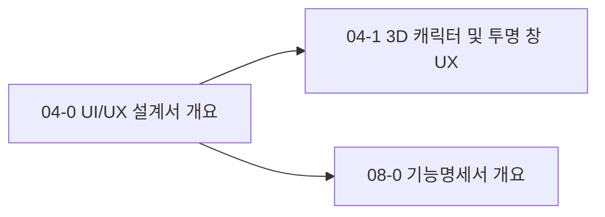

# 04-0. UI/UX 설계서 개요

## 기준선
| 항목 | 내용 |
| --- | --- |
| 기준 릴리스 | `v0.1.9` (`0c85f5c`) |
| 렌더링 기반 | WPF `Viewport3D` + `HelixToolkit.Wpf 3.1.2` (`AllowsTransparency="True"`) |
| 트레이 UI | `H.NotifyIcon.Wpf 2.3.0` |

## 문서 맵

## 화면 인벤토리
| 화면 ID | XAML 파일 | 역할 |
| --- | --- | --- |
| `SCR-01` | [OnboardingWindow.xaml](../../src/LabPet.Client/Views/OnboardingWindow.xaml) | 최초 온보딩 마법사 및 외형·이름 편집 (360도 턴테이블) |
| `SCR-02` | [PetWindow.xaml](../../src/LabPet.Client/Views/PetWindow.xaml) | 바탕화면 상주 투명 3D 펫 창, 상단 말풍선 `Popup`, 친구 오버레이, 시스템 트레이 메뉴 |
| `SCR-03` | [SoloHubWindow.xaml](../../src/LabPet.Client/Views/SoloHubWindow.xaml) | 개인 성장 · 오디오 모니터 · 뽀모도로 타이머 · 4종 코인 게임 허브 |
| `SCR-04` | [SocialWindow.xaml](../../src/LabPet.Client/Views/SocialWindow.xaml) | 친구 3D 프리뷰 · 말풍선 메시지 · 상태별 노래 따라하기 · 주변 LAN 펫 탐색 |
| `SCR-05` | [EnvironmentGuideWindow.xaml](../../src/LabPet.Client/Views/EnvironmentGuideWindow.xaml) | 방화벽 PowerShell 명령 원클릭 복사 및 SmartScreen 안내 |
| `SCR-06` | [VisitorPetWindow.xaml](../../src/LabPet.Client/Views/VisitorPetWindow.xaml) | 내 바탕화면 옆 방문 친구 3D 펫 창 (크기·투명도 공유, 호버 `✕` 돌려보내기) |

---
[개요](./04-0_UI_UX_설계서_개요.md) | [다음: 04-1 3D 캐릭터 및 투명 창 UX →](./04-1_3D캐릭터_및_투명창_UX.md)
