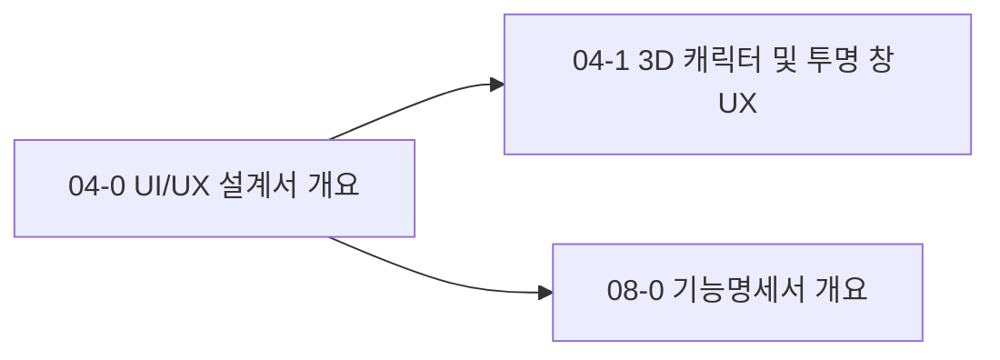

# 04-0. UI/UX 설계서 개요

## 기준선
| 항목 | 내용 |
| --- | --- |
| 기준선 | 통합 관리 창(`HubWindow`) Win11 디자인 개편 및 단일 내비게이션 적용 |
| 렌더링 기반 | WPF `Viewport3D` + `HelixToolkit.Wpf 3.1.2` (`AllowsTransparency="True"`) + [HubDesignSystem.xaml](../../src/LabPet.Client/Themes/HubDesignSystem.xaml) |
| 트레이 · 우클릭 메뉴 | `H.NotifyIcon.Wpf 2.3.0` + [PetContextMenuFactory.cs](../../src/LabPet.Client/Views/PetContextMenuFactory.cs) |

## 문서 맵

## 화면 인벤토리
| 화면 ID | XAML 파일 | 역할 |
| --- | --- | --- |
| `SCR-01` | [OnboardingWindow.xaml](../../src/LabPet.Client/Views/OnboardingWindow.xaml) | 최초 실행 온보딩 마법사 (공용 [PetAppearanceEditorControl.xaml](../../src/LabPet.Client/Views/Controls/PetAppearanceEditorControl.xaml) 호스팅) |
| `SCR-02` | [PetWindow.xaml](../../src/LabPet.Client/Views/PetWindow.xaml) | 바탕화면 상주 투명 3D 펫 창, 상단 말풍선 `Popup`, 친구 오버레이, 우클릭·트레이 공용 메뉴 |
| `SCR-03` | [HubWindow.xaml](../../src/LabPet.Client/Views/Hub/HubWindow.xaml) | 단일 인스턴스 통합 관리 창 (접힘 가능 좌측 사이드바, 48 DIP 공용 헤더, 상단 슬림 초대 배너, 8방향 리사이즈, `hub-ui.json` 위치/크기 복원) |
| `SCR-03A` | [HomePageView.xaml](../../src/LabPet.Client/Views/Hub/Pages/HomePageView.xaml) | 홈 대시보드 (프로필·XP·코인·온라인 친구·뽀모도로·연결 상태 요약 및 빠른 실행) |
| `SCR-03B` | [AppearancePageView.xaml](../../src/LabPet.Client/Views/Hub/Pages/AppearancePageView.xaml) | 외형·이름·크기·투명도 편집 (공용 `PetAppearanceEditorControl`, 미저장 이탈 가드 `IHubUnsavedChangesGuard`) |
| `SCR-03C` | [FriendsPageView.xaml](../../src/LabPet.Client/Views/Hub/Pages/FriendsPageView.xaml) | 내 친구 3D 프리뷰 · 말풍선 · 노래 따라하기 & 주변/온라인 펫 탐색 세그먼트 전환 |
| `SCR-03D` | [GrowthPageView.xaml](../../src/LabPet.Client/Views/Hub/Pages/GrowthPageView.xaml) | 레벨·활동량 기록·코인 획득 가이드·실시간 WASAPI 오디오 반응 |
| `SCR-03E` | [PomodoroPageView.xaml](../../src/LabPet.Client/Views/Hub/Pages/PomodoroPageView.xaml) | 15/25/50분 뽀모도로 집중·휴식 타이머 (백그라운드 유지) |
| `SCR-03F` | [GamesPageView.xaml](../../src/LabPet.Client/Views/Hub/Pages/GamesPageView.xaml) · [GamesHubView.xaml](../../src/LabPet.Client/Views/Games/GamesHubView.xaml) | 2×2 카드형 게임 대시보드 및 4종 미니게임(`HiLowGameView`, `RpsGameView`, `TypingGameView`, `LadderGameView`) |
| `SCR-03G` | [SeasonalPageView.xaml](../../src/LabPet.Client/Views/Hub/Pages/SeasonalPageView.xaml) | 확장형 시즌 콘텐츠 허브 (실구현 항목만 표시 — 터미널 크리스마스 트리) |
| `SCR-03H` | [SettingsPageView.xaml](../../src/LabPet.Client/Views/Hub/Pages/SettingsPageView.xaml) | 일반(자동 실행·위치 초기화), 표시(크기·투명도·클릭 투과), 데이터 저장소 경로 · 폴더 열기 |
| `SCR-03I` | [AboutPageView.xaml](../../src/LabPet.Client/Views/Hub/Pages/AboutPageView.xaml) | 설치 버전(`v0.3.5`), Velopack 업데이트 확인·적용(`HubNavigationAction.CheckUpdates`), 저장소·릴리스 노트 링크, 오픈소스 라이선스 |
| `SCR-06` | [VisitorPetWindow.xaml](../../src/LabPet.Client/Views/VisitorPetWindow.xaml) | 내 바탕화면 옆 방문 친구 3D 펫 창 (크기·투명도 공유, 호버 `✕` 돌려보내기) |
| `SCR-07` | [GameInviteCardWindow.xaml](../../src/LabPet.Client/Views/GameInviteCardWindow.xaml) | 통합 창이 닫혀 있거나 최소화되었을 때 펫 주변에 표시되는 비활성화 독립 초대 카드 |

---
[개요](./04-0_UI_UX_설계서_개요.md) | [다음: 04-1 3D 캐릭터 및 투명 창 UX →](./04-1_3D캐릭터_및_투명창_UX.md)
