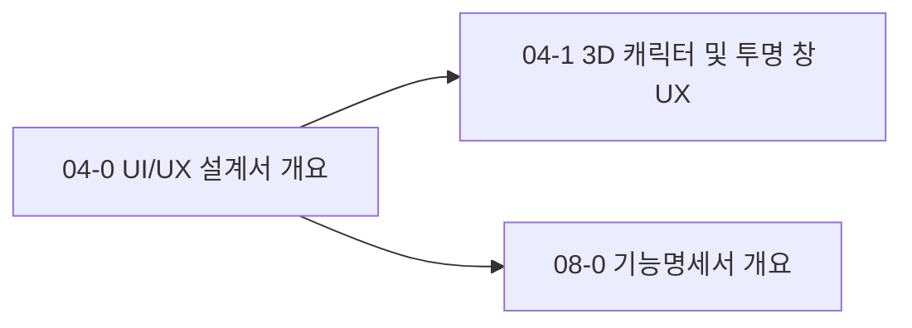

# 04-0. UI/UX 설계서 개요

## 기준선
| 항목 | 내용 |
| --- | --- |
| 기준 릴리스 | `v0.1.5` (`49d7700`) |
| 렌더링 기반 | WPF `Viewport3D` + `HelixToolkit.Wpf 3.1.2` (`AllowsTransparency="True"`) |
| 트레이 UI | `H.NotifyIcon.Wpf 2.3.0` |

## 문서 맵

## 화면 인벤토리
| 화면 ID | XAML 파일 | 역할 |
| --- | --- | --- |
| `SCR-01` | [OnboardingWindow.xaml](../../src/LabPet.Client/Views/OnboardingWindow.xaml) | 최초 온보딩 마법사 및 외형·이름 편집 (360도 턴테이블) |
| `SCR-02` | [PetWindow.xaml](../../src/LabPet.Client/Views/PetWindow.xaml) | 바탕화면 상주 투명 3D 펫 창 및 시스템 트레이 메뉴 |

---
[개요](./04-0_UI_UX_설계서_개요.md) | [다음: 04-1 3D 캐릭터 및 투명 창 UX →](./04-1_3D캐릭터_및_투명창_UX.md)
