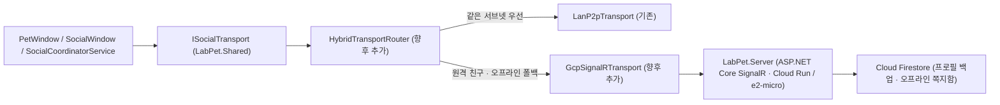

# 07. 향후 `LabPet.Server` (GCP SignalR + Cloud Firestore) 확장 가이드

## 1. 기존 클라이언트 무수정 확장 구조
`LabPet.Client`의 모든 View와 ViewModel은 구체 클래스(`LanP2pTransport`)가 아니라 [ISocialTransport.cs](../src/LabPet.Shared/Transport/ISocialTransport.cs) 인터페이스만 의존합니다. 또한 [PetProfile.cs](../src/LabPet.Shared/Models/PetProfile.cs)에는 이미 `SyncMetadata`(`CloudUserId`, `LastSyncedAtUtc`, `Revision`)가 포함되어 있습니다.

## 2. 향후 추가할 프로젝트 및 컴포넌트
1. **`src/LabPet.Server/` (ASP.NET Core `.NET 10` + SignalR)**:
   - `LabPet.Shared` 프로젝트 참조로 `PetProfile`, `ControlPacketEnvelope`, `MusicFramePacket`, `ProtocolConstants` 재사용
   - `SocialHub : Hub`: 원격 온라인 프레즌스, 친구 요청 중계, 30Hz 노래 따라하기 그룹 릴레이
   - **Cloud Firestore 컬렉션 설계**:
     - `profiles/{petId}`: `PetProfile` + `SyncMetadata.Revision` 낙관적 동시성 백업
     - `offlineMessages/{targetPetId}/inbox/{messageId}`: 오프라인 친구에게 보낸 말풍선 쪽지 보관 후 접속 시 전달
2. **`GcpSignalRTransport : ISocialTransport`**:
   - `Microsoft.AspNetCore.SignalR.Client`로 `SocialHub` 연결, 기존 `ISocialTransport` 이벤트를 그대로 발생
3. **`HybridTransportRouter : ISocialTransport`**:
   - 대상 `petId`가 `LanP2pTransport.GetDiscoveredPeers()`에 온라인으로 존재하면 LAN 직접 전송(지연 최소화), 없으면 `GcpSignalRTransport`로 자동 폴백
   - `App.xaml.cs`의 DI 등록 1줄(`services.AddSingleton<ISocialTransport, HybridTransportRouter>()`) 교체만으로 전체 UI에 적용
4. **업데이트 피드 GCP Cloud Storage 이전**:
   - `UpdateSourceOptions.Provider = UpdateProviderKind.SimpleWeb`
   - `UpdateSourceOptions.SimpleWebFeedUrl = "https://storage.googleapis.com/<bucket>/win-x64"`
