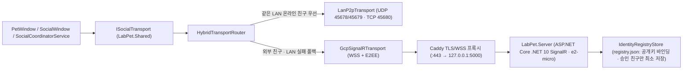

# 07. `LabPet.Server` (GCP SignalR 실시간 중계 + 하이브리드 연동)

## 1. 클라이언트 무변경 하이브리드 구조
`LabPet.Client`의 모든 View와 ViewModel은 구체 구현체가 아니라 [ISocialTransport.cs](../src/LabPet.Shared/Transport/ISocialTransport.cs) 인터페이스만 의존합니다.

## 2. 구현 구성 및 보안·메시지 비저장 정책
1. **`src/LabPet.Server` (ASP.NET Core `.NET 10` + SignalR WebSocket)**:
   - **메모리 실시간 접속·중계**: 채팅 메시지·빠른 반응·쓰다듬기·게임 이벤트·오프라인 쪽지를 일체 저장하지 않으며, 오프라인 수신자 대상 전송은 즉시 거부(`RECIPIENT_OFFLINE`)합니다.
   - **기기 식별 인증 (`ECDSA P-256` 챌린지-응답)**: `/api/auth/challenge`(1회용 60초 nonce) → `/api/auth/token`(HMAC-SHA256 단기 Bearer 토큰). 동일 `PetId`에 다른 기기 공개키로 접속 시도 시 `403` 차단.
   - **최소 영속 데이터 (`registry.json`)**: 기기 공개키 바인딩(`PetId ↔ PublicKey`)과 승인된 친구 관계(`ApprovedFriendships`/`DeclaredFriends`)만 원자적으로 저장하며, 메시지 본문/암호문은 전혀 기록하지 않습니다.
   - **E2EE + 상호 친구 인가**: 친구 제어 패킷은 기존 `PacketCrypto`(AES-256-GCM)와 `PacketSigner`(HMAC-SHA256)로 종단 간 암호화된 봉투(`IsEncrypted = true`)만 상호 친구 사이에서 중계합니다.
   - **원격 30Hz 노래 따라하기 트래픽 절감**: LAN 구독은 30Hz UDP를 유지하며, GCP 원격 중계는 실제 원격 구독자가 1명 이상 있을 때만 활성화하고 `18fps` 상한(클라이언트 ~`15Hz` 스로틀링)으로 제어합니다.
2. **Windows 클라이언트 연동 (`LabPet.Client`)**:
   - [DeviceIdentityStore.cs](../src/LabPet.Client/Storage/DeviceIdentityStore.cs): `%AppData%\LabPet\device_identity.json`에 ECDSA P-256 키쌍을 DPAPI 보호 저장.
   - [ServerConnectionOptions.cs](../src/LabPet.Client/Network/ServerConnectionOptions.cs): `LABPET_SERVER_URL` 환경변수 → `%AppData%\LabPet\server.json` → 릴리스 빌드 주입 기본값(`LabPetDefaultServerUrl`) 순으로 로드(모두 미설정 시 원격 비활성·LAN 전용 동작).
   - [GcpSignalRTransport.cs](../src/LabPet.Client/Network/GcpSignalRTransport.cs): 자동 재연결, 기존 `주변 펫` 목록 호환 공개 펫 탐색(비친구는 음악/수면/친구코드 비노출) 및 P-256 ECDH 친구 신청·수락, E2EE 중계.
   - [HybridTransportRouter.cs](../src/LabPet.Client/Network/HybridTransportRouter.cs): LAN 우선 · GCP 자동 폴백 · 이중 경로 중복 수신 차단.
3. **GCP VM 배포 구성 ([deploy/gcp/README.md](../deploy/gcp/README.md))**:
   - Ubuntu 24.04 LTS Compute Engine VM(`e2-micro` 등)에서 Caddy(TCP 80/443 HTTPS/WSS) → `127.0.0.1:5000` systemd 서비스로 운영하며, Cloud Firestore·Cloud SQL·Cloud Run 등 유료 부가 서비스는 사용하지 않습니다.
