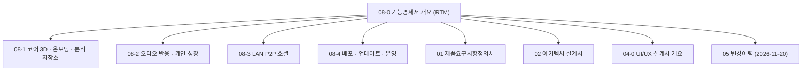

# 08-0. 기능명세서 개요 및 전체 추적성 매트릭스 (RTM)

## 형상 상태 범례

표의 기준은 릴리스 `v0.1.5` (`49d7700`)다. 이후 수정과 확인 결과는 [변경 이력](../05_변경이력/2026-11-20.md)에 기록한다.

- `구현완료`: 기준 릴리스에 구현 포함
- `작업중(미커밋)`: 현재 워킹 트리에서 구현·검증 완료되었으나 아직 커밋 전 상태
- `명시적제외`: 현재 단계 범위 외 항목

## 지식 그래프

## 전체 기능 추적성 매트릭스 (RTM)
| 기능 ID | 기능명 | 상세 문서 링크 | 대상 모듈/화면 ID | 관련 표준 문서 | 주요 구현 파일 링크 | 검증 스위트 링크 | 기준 커밋 | 형상 상태 |
| --- | --- | --- | --- | --- | --- | --- | --- | --- |
| `FT-01` | 공용 프로토콜·모델·`ISocialTransport` | [08-1](./08-1_코어3D_온보딩_저장소.md) | `MOD-01` | [03 프로토콜](../03_네트워크_프로토콜_및_보안명세.md) | [ISocialTransport.cs](../../src/LabPet.Shared/Transport/ISocialTransport.cs) | [ProtocolAndSignerTests.cs](../../tests/LabPet.Tests/ProtocolAndSignerTests.cs) | `49d7700` | 구현완료 |
| `FT-02` | 절차적 3D 캐릭터 4종, 커스텀 레이어, 메시 공유 및 미니 키보드 | [08-1](./08-1_코어3D_온보딩_저장소.md) | `MOD-02` | [04-1 UI/UX](../04_UI_UX_설계서/04-1_3D캐릭터_및_투명창_UX.md) | [ProceduralPetMeshFactory.cs](../../src/LabPet.Client/Rendering/ProceduralPetMeshFactory.cs) | [MeshFactoryTests.cs](../../tests/LabPet.Tests/MeshFactoryTests.cs) | `49d7700` | 구현완료 |
| `FT-03` | 360도 3D 턴테이블 온보딩 및 편집 | [08-1](./08-1_코어3D_온보딩_저장소.md) | `SCR-01` | [04-1 UI/UX](../04_UI_UX_설계서/04-1_3D캐릭터_및_투명창_UX.md) | [OnboardingWindow.xaml.cs](../../src/LabPet.Client/Views/OnboardingWindow.xaml.cs) | 수동 검증 | `49d7700` | 구현완료 |
| `FT-04` | 펫 창, 50~150% 크기 조절, 창 외곽 친구 오버레이, 친구 프로필이 붙은 말풍선 최대 5개, 하단 조절 영역을 포함한 투명도, 트레이 | [08-1](./08-1_코어3D_온보딩_저장소.md) | `SCR-02` | [04-1 UI/UX](../04_UI_UX_설계서/04-1_3D캐릭터_및_투명창_UX.md) | [PetWindow.xaml](../../src/LabPet.Client/Views/PetWindow.xaml), [PetWindow.xaml.cs](../../src/LabPet.Client/Views/PetWindow.xaml.cs), [App.xaml.cs](../../src/LabPet.Client/App.xaml.cs) | [StorageAndMigratorTests.cs](../../tests/LabPet.Tests/StorageAndMigratorTests.cs), [SocialCoordinatorTests.cs](../../tests/LabPet.Tests/SocialCoordinatorTests.cs), [PetOverlayPlacementTests.cs](../../tests/LabPet.Tests/PetOverlayPlacementTests.cs), WPF 배치 확인 및 수동 검증 | `49d7700` | 구현완료 |
| `FT-05` | `%AppData%\LabPet\` 원자적 저장·마이그레이션 | [08-1](./08-1_코어3D_온보딩_저장소.md) | `MOD-03` | [02 아키텍처](../02_아키텍처_설계서.md) | [JsonAppDataStore.cs](../../src/LabPet.Client/Storage/JsonAppDataStore.cs) | [StorageAndMigratorTests.cs](../../tests/LabPet.Tests/StorageAndMigratorTests.cs) | `49d7700` | 구현완료 |
| `FT-06` | `NAudio` 루프백 오디오 FFT·비트·핫스왑 | [08-2](./08-2_오디오반응_및_개인성장.md) | `MOD-04` | [02 아키텍처](../02_아키텍처_설계서.md) | [LoopbackAudioAnalyzer.cs](../../src/LabPet.Client/Audio/LoopbackAudioAnalyzer.cs) | [AudioAndSoloTests.cs](../../tests/LabPet.Tests/AudioAndSoloTests.cs) | `49d7700` | 구현완료 |
| `FT-07` | 캐릭터별 3D 리듬 애니메이션·타이핑 앞발·키보드 방향 | [08-2](./08-2_오디오반응_및_개인성장.md) | `MOD-02` | [04-1 UI/UX](../04_UI_UX_설계서/04-1_3D캐릭터_및_투명창_UX.md) | [PetAnimationController.cs](../../src/LabPet.Client/Rendering/PetAnimationController.cs), [ProceduralPetMeshFactory.cs](../../src/LabPet.Client/Rendering/ProceduralPetMeshFactory.cs) | [MeshFactoryTests.cs](../../tests/LabPet.Tests/MeshFactoryTests.cs) | `49d7700` | 구현완료 |
| `FT-08` | 활동량·뽀모도로·4종 코인 게임 허브 (`SoloHub`) | [08-2](./08-2_오디오반응_및_개인성장.md) | `MOD-07`, `SCR-03` | [01 PRD](../01_제품요구사항정의서.md) | [SoloHubWindow.xaml.cs](../../src/LabPet.Client/Views/SoloHubWindow.xaml.cs), [CoinGamesViewModel.cs](../../src/LabPet.Client/ViewModels/CoinGamesViewModel.cs) | [AudioAndSoloTests.cs](../../tests/LabPet.Tests/AudioAndSoloTests.cs), [CoinGamesTests.cs](../../tests/LabPet.Tests/CoinGamesTests.cs) | `0c85f5c` | 구현완료 |
| `FT-09` | 물리 어댑터 필터링 UDP 탐색·버전 호환 배지 | [08-3](./08-3_LAN_P2P_소셜.md) | `MOD-05` | [03 프로토콜](../03_네트워크_프로토콜_및_보안명세.md) | [LanNetworkHelper.cs](../../src/LabPet.Client/Network/LanNetworkHelper.cs) | [LanP2pTransportTests.cs](../../tests/LabPet.Tests/LanP2pTransportTests.cs) | `0c85f5c` | 구현완료 |
| `FT-10` | v3 수락 버튼으로 친구 등록·자동 키 합의·서명된 ACK·탐색 검증·빠른 메시지·받은 메시지 프로필·상태별 노래 따라하기·방문 펫(`VisitorPetWindow`)·LAN 게임 이벤트 | [08-3](./08-3_LAN_P2P_소셜.md) | `SCR-04`, `SCR-06` | [03 프로토콜](../03_네트워크_프로토콜_및_보안명세.md) | [LanP2pTransport.cs](../../src/LabPet.Client/Network/LanP2pTransport.cs), [SocialCoordinatorService.cs](../../src/LabPet.Client/Social/SocialCoordinatorService.cs), [VisitorPetWindow.xaml.cs](../../src/LabPet.Client/Views/VisitorPetWindow.xaml.cs), [PetPortraitRenderer.cs](../../src/LabPet.Client/Rendering/PetPortraitRenderer.cs) | [LanP2pTransportTests.cs](../../tests/LabPet.Tests/LanP2pTransportTests.cs), [SocialCoordinatorTests.cs](../../tests/LabPet.Tests/SocialCoordinatorTests.cs) | `0c85f5c` | 구현완료 |
| `FT-11` | Velopack 진입점·`UpdateService` 차분 업데이트 | [08-4](./08-4_배포_업데이트_운영.md) | `MOD-06` | [06 배포가이드](../06_배포_자동업데이트_및_방화벽가이드.md) | [UpdateService.cs](../../src/LabPet.Client/Updates/UpdateService.cs) | [UpgradeAndUpdateTests.cs](../../tests/LabPet.Tests/UpgradeAndUpdateTests.cs) | `49d7700` | 구현완료 |
| `FT-12` | Windows PR 검증·GitHub Actions 릴리스·시작 프로그램·환경 안내 | [08-4](./08-4_배포_업데이트_운영.md) | `SCR-05` | [06 배포가이드](../06_배포_자동업데이트_및_방화벽가이드.md) | [release.yml](../../.github/workflows/release.yml) | [UpgradeAndUpdateTests.cs](../../tests/LabPet.Tests/UpgradeAndUpdateTests.cs) | `49d7700` | 구현완료 |

---
[개요](./08-0_기능명세서_개요.md) | [다음: 08-1 코어 3D · 온보딩 · 분리 저장소 →](./08-1_코어3D_온보딩_저장소.md)
